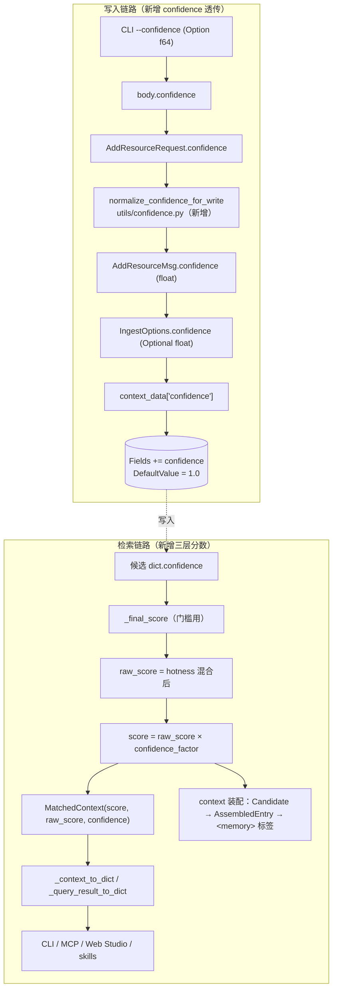
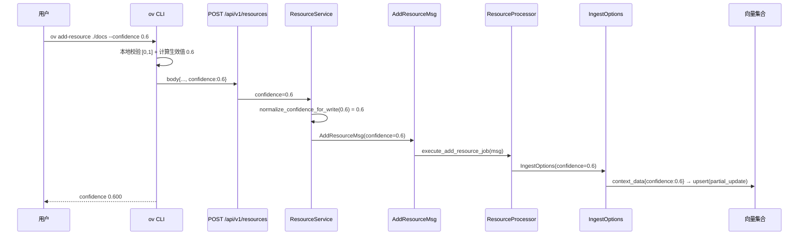
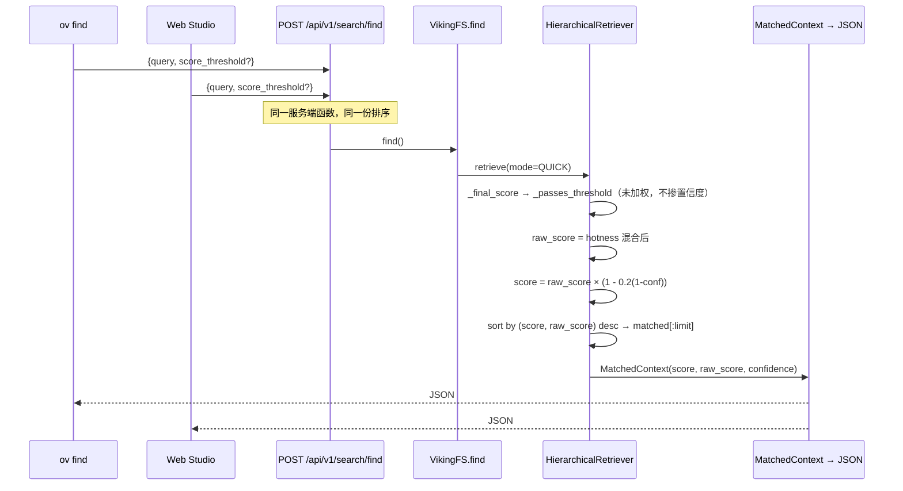

# OpenViking 资源置信度（resource confidence）任务设计

## 文档信息

- **项目名称**: OpenViking（代码库根目录 `prds/OpenViking`，git HEAD `02fb0543`）
- **创建日期**: 2026-10-10
- **版本**: v1.1
- **状态**: 已确认
- **相关需求**: `spec/resource-confidence/requirements.md` v1.8

> 本文件为**设计基线**，已由客户于 2026-10-10 以口令「确认设计」确认。后续变更须走设计变更流程并升版本。

## 系统架构

### 现有架构分析

改造涉及**两条互相独立、只在存储层交汇**的链路。

**写入链路**（`add-resource`）：


**检索链路**（`find` / `search` / `skills find`）：


**现有架构的关键缺口**（与需求 R-2 / R-9 对应）：

1. `IngestOptions`（`utils/ingest_options.py:13-59`）只承载 `search_tags` / `search_tag_mode`，无资源级标量位置。
2. `collection_schemas.context_collection`（`collection_schemas.py:71-165`）的 `Fields` 无 `confidence`；集合**只在不存在时创建**（`:274-311`），自动迁移已被提交 `4d00feac` 删除。
3. 检索输出走**多道字段白名单**：`RETRIEVAL_OUTPUT_FIELDS`（`viking_vector_index_backend.py:34-42`）→ `MatchedContext` → `_context_to_dict`（`types.py:376-383`）→ context 装配链 `Candidate`（`gather.py:33-46`）→ `AssembledEntry`（`models.py:17-23`）→ 各展示面。**任一道白名单不同步，字段即静默丢失**（R-9）。
4. `_convert_to_matched_contexts`（`:590-658`）只产出单一 `score`，调用方无法拆解。

### 优化后的架构



**架构模式**：不引入新的分层或抽象。改造沿用代码库既有的三个扩展点 —— ① `IngestOptions`（写入侧标的载体）；② 字段白名单序列（读取侧投影）；③ `_convert_to_matched_contexts`（打分唯一出口）。新增一个纯函数工具模块 `openviking/utils/confidence.py` 承载校验与归一化。

### 组件关系图

```
                         ┌──────────────────────────────┐
                         │ utils/confidence.py（新增）   │
                         │  normalize_confidence_for_write │
                         │  coerce_confidence_for_read     │
                         │  confidence_factor              │
                         └───────┬──────────────┬────────┘
                                 │写侧校验       │读侧兜底 + 折扣
                                 ▼              ▼
  CLI ──► REST ──► Service ──► Msg ──► IngestOptions ──► context_data ──► 向量集合
                                                                          │
                    ┌─────────────────────────────────────────────────────┘
                    ▼
  检索输出白名单(RETRIEVAL_OUTPUT_FIELDS) ──► 候选 dict ──► HierarchicalRetriever
                                                                │
                            ┌───────────────────────────────────┤
                            ▼                                   ▼
                    MatchedContext                       context 装配 Candidate
                            │                                   │
                    _context_to_dict                     AssembledEntry
                            │                                   │
                  REST JSON ─┴──────────► CLI / MCP / Web Studio / skills / <memory>
```

### 技术栈

沿用现网技术栈，**不引入任何新依赖**：

- **前端**: Web Studio（React + TypeScript，Vite；`web-studio/`）
- **后端**: Python 3（FastAPI + Pydantic v2；`openviking/`）
- **CLI**: Rust（clap derive；`crates/ov_cli/`）
- **存储**: 向量集合（VikingDB / 本地集合 / Volcengine / Http 四种适配器；`openviking/storage/vectordb_adapters/`）
- **消息队列**: 现有 fs 队列（`openviking/storage/queuefs/`）
- **缓存**: 不涉及
- **数据库**: 无关系库、无 SQL、无多方言问题（详见"数据库设计"）

## 核心组件设计

> 依"代码片段边界规则"：新增文件展示完整代码；修改现有方法只展示 diff 并标注"原有逻辑保留，见原文件:行号"；未变更代码不重复展示。

### C1: 置信度工具模块（**新增文件**）

**文件**: `openviking/utils/confidence.py`

**职责**: 统一置信度的写侧校验、读侧兜底与折扣因子计算，避免校验口径散落在 CLI / 路由 / service / 检索四处。

```python
# Copyright (c) 2026 Beijing Volcano Engine Technology Co., Ltd.
# SPDX-License-Identifier: AGPL-3.0
"""Human-assigned resource confidence: validation, coercion and discounting."""

from __future__ import annotations

import math
from typing import Any, Optional

from openviking_cli.exceptions import InvalidArgumentError

CONFIDENCE_FIELD = "confidence"
DEFAULT_CONFIDENCE = 1.0
MIN_CONFIDENCE = 0.0
MAX_CONFIDENCE = 1.0


def normalize_confidence_for_write(value: Any) -> float:
    """Validate a caller-supplied confidence.

    ``None`` means "not supplied" and resolves to ``DEFAULT_CONFIDENCE``.
    Out-of-range, non-numeric and non-finite values are rejected instead of
    being silently clamped, so a typo cannot turn into a silent ranking change.
    """
    if value is None:
        return DEFAULT_CONFIDENCE
    try:
        confidence = float(value)
    except (TypeError, ValueError) as exc:
        raise InvalidArgumentError(
            f"confidence must be a number, got {value!r}"
        ) from exc
    if not math.isfinite(confidence):
        raise InvalidArgumentError("confidence must be a finite number")
    if confidence < MIN_CONFIDENCE or confidence > MAX_CONFIDENCE:
        raise InvalidArgumentError(
            f"confidence must be within [{MIN_CONFIDENCE}, {MAX_CONFIDENCE}], got {confidence}"
        )
    return confidence


def coerce_confidence_for_read(value: Any) -> float:
    """Coerce a stored confidence into the legal range.

    Read-side defence independent of the write-side check: legacy records,
    ovpack restores and direct vector writes never passed through validation.
    ``1.5`` would otherwise produce a factor above 1.0 (a reverse boost).
    """
    if value is None:
        return DEFAULT_CONFIDENCE
    try:
        confidence = float(value)
    except (TypeError, ValueError):
        return DEFAULT_CONFIDENCE
    if not math.isfinite(confidence):
        return DEFAULT_CONFIDENCE
    return min(MAX_CONFIDENCE, max(MIN_CONFIDENCE, confidence))


def confidence_factor(confidence: float, penalty_lambda: float) -> float:
    """Bounded discount factor: ``1 - lambda * (1 - confidence)``.

    ``confidence == 1.0`` yields exactly ``1.0`` so untouched records keep
    bit-identical scores; ``confidence == 0.0`` yields ``1 - lambda``.
    """
    return 1.0 - penalty_lambda * (1.0 - confidence)
```

### C2: 集合 Schema 与存量集合检测

**文件**: `openviking/storage/collection_schemas.py`

**变更 1 —— `CollectionSchemas.context_collection` 新增字段**（`:84-133` 的 `fields` 列表内；`ScalarIndex` `:134-153` **本期不加**）：

```python
                {"FieldName": "search_tags", "FieldType": "list<string>"},
                # 人工标注的资源可信度；缺省 1.0 = 不折扣。
                # DefaultValue 必须显式声明：data_processor.py 的
                # TYPE_DEFAULTS["float32"] 是 0.0，缺省会把未标注记录的分数清零。
                {"FieldName": "confidence", "FieldType": "float32", "DefaultValue": 1.0},
                {"FieldName": "abstract", "FieldType": "string"},
```

**变更 2 —— `init_context_collection` 增加存量集合字段检测**（对应 FR-007），插入点为 `existing_meta` **非空校验之后**（`collection_schemas.py:321` 之后；`:313-320` 的 `hasattr` 守卫与 `if not existing_meta: raise` 均保留不动）：

```python
    # 原有逻辑保留，见 collection_schemas.py:313-320
    #   if hasattr(storage, "get_collection_meta"):
    #       existing_meta = await storage.get_collection_meta()
    #   if not existing_meta:
    #       raise EmbeddingConfigurationError(...)

    # 新增：存量集合可能缺 confidence 字段。集合只在不存在时创建，
    # 且自动 schema 迁移已被移除，因此这里必须给出可观测信号，
    # 而不是让后续写入被 _filter_known_fields 静默丢弃。
    existing_fields = {
        item.get("FieldName") for item in (existing_meta.get("Fields") or [])
    }
    if existing_fields and CONFIDENCE_FIELD not in existing_fields:
        logger.warning(
            "[CollectionSchema] Existing collection %s lacks the %r field; "
            "resources imported with a confidence value will be stored with the "
            "field dropped. Recreate the collection (or add the field out of band) "
            "to enable resource confidence.",
            collection_name,
            CONFIDENCE_FIELD,
        )
```

新增导入：`from openviking.utils.confidence import CONFIDENCE_FIELD`。

### C3: 读取侧字段白名单（两处）

**文件**: `openviking/storage/viking_vector_index_backend.py`

**变更 1 —— `RETRIEVAL_OUTPUT_FIELDS`**（`:34-42`，检索候选 dict 的投影来源，不加则检索阶段根本取不到该字段）：

```python
RETRIEVAL_OUTPUT_FIELDS = [
    "uri",
    "level",
    "context_type",
    "abstract",
    "active_count",
    "updated_at",
    "search_tags",
    "confidence",   # 新增
]
```

**变更 2 —— `FETCH_BY_URI_OUTPUT_FIELDS`**（`:50-66`，`fetch_by_uri` / `update_search_tags` 等回读路径）：

```python
FETCH_BY_URI_OUTPUT_FIELDS = [
    # 原有 15 项保留，见 viking_vector_index_backend.py:51-65
    "owner_user_id",
    "confidence",   # 新增
]
```

> `LOOKUP_OUTPUT_FIELDS`（`:44-48`）与 `ScalarIndex` **本期不改**：需求明确本期不做按置信度服务端过滤，避免引入无使用方的索引。

### C4: 备份 / 迁移字段白名单（三套，缺一即丢字段）

| 文件 | 位置 | 变更 |
|------|------|------|
| `openviking/storage/ovpack/index.py` | `PORTABLE_VECTOR_SCALAR_FIELDS`（`:22-31`） | 追加 `"confidence"`（`EXPORT_VECTOR_FIELDS` 由它派生，无需单独改） |
| `openviking/utils/embedding_utils.py` | `_PORTABLE_SCALAR_FIELDS`（`:65-74`） | frozenset 追加 `"confidence"` —— 这是 ovpack **import recompute 分支**的写入白名单，经 `ovpack/operations.py:365-372 → index_dir/index_file → _apply_scalar_overrides` 生效；不改则 import 重新向量化时丢失 |
| `openviking/storage/vector_migration.py` | `VECTOR_MIGRATION_OUTPUT_FIELDS`（`:18-35`） | 追加 `"confidence"`（读侧投影；`:170-188` 的 payload 为黑名单式透传，无需改） |

### C5: 写入侧标量载体 `IngestOptions`

**文件**: `openviking/utils/ingest_options.py`

**变更（修改现有 dataclass，diff）**：

```python
@dataclass(frozen=True)
class IngestOptions:
    """...原有 docstring 保留，见 ingest_options.py:13-21"""

    search_tags: Optional[list[str]] = None
    search_tag_mode: str = "replace"
    # 新增：None 表示"本次调用不携带置信度"（partial_update 将保留旧值）。
    # add-resource 主链路始终显式携带（含缺省 1.0），因此重复导入会覆盖旧值；
    # 重写/重索引路径不携带，因此保留人工标注。
    confidence: Optional[float] = None
```

`from_value`（`:40-53`）追加：

```python
        return cls(
            search_tags=(
                list(value.get("search_tags") or [])
                if value.get("search_tags") is not None
                else None
            ),
            search_tag_mode=str(value.get("search_tag_mode", "replace")),
            confidence=value.get("confidence"),   # 新增
        )
```

`to_dict`（`:55-58`）追加 `"confidence": self.confidence,`。

`from_search_tags`（`:26-38`）**保持不变**（它只负责 tags；置信度由调用方另行传入）。

**作用粒度（对应 FR-006）**：置信度的作用域由"**单次请求携带单一 `confidence` 值**"决定 —— 该值随 `IngestOptions` 沿 `resource_processor.finish_prepared_resource` 广播到本次导入产生的**全部** L0/L1/L2 记录（`embedding_utils.py:423`、`:470`、`:631` 三处调用点共享同一 `ingest_options`），因此目录导入时目录下每个文件及其摘要记录同值。**本期不实现 `--confidence-map`**（目录内高低置信混排需按目录/批次分批导入，见 FR-006 AC2）。该行为由 TC-01 / TC-02 覆盖。

### C6: 落库写入点

**文件**: `openviking/utils/embedding_utils.py`

**变更 —— `_apply_ingest_options`（`:86-96`）**：把"仅按 search_tags 早退"拆成两个独立分支，否则"只带 confidence、不带 tags"的导入到不了 `context_data`。

```python
def _apply_ingest_options(
    embedding_msg,
    ingest_options: IngestOptions | None,
) -> None:
    # 原有逻辑保留，见 embedding_utils.py:86-90（from_value 与 embedding_msg 空值守卫）
    ...
    if ingest_options.search_tags is not None:
        # 原有逻辑保留，见 embedding_utils.py:93-95
        embedding_msg.context_data["search_tags"] = list(ingest_options.search_tags or [])
        embedding_msg.context_data["_upsert_options"] = {
            "search_tag_mode": ingest_options.search_tag_mode
        }
    # 新增：只有显式携带时才写入，使 partial_update 的重写路径保留旧值。
    if ingest_options.confidence is not None:
        embedding_msg.context_data[CONFIDENCE_FIELD] = coerce_confidence_for_read(
            ingest_options.confidence
        )
```

> 关键改动只有两点：① 原 `:91` 的 `if not embedding_msg or ingest_options.search_tags is None: return` 拆为"仅守 `embedding_msg`" + 两个独立 `if`；② 新增 `confidence` 分支。
> **新增导入**：`from openviking.utils.confidence import CONFIDENCE_FIELD, coerce_confidence_for_read`（`embedding_utils.py` 现有导入见 `:37`）。

三个调用点（`:423` L0、`:470` L1、`:631` L2）**不变**，自动获得新行为。

> 机制说明（R-8 留痕，顺序已按实测校正）：`collection_schemas.py:793-796` 无条件强制 `partial_update: True`；`viking_vector_index_backend.upsert` 的合并发生在 `:361`（`existing.update({k: v for k, v in payload.items() if v is not None})`，**跳过 `None`**），schema 过滤 `_filter_known_fields` 更在其后的 `_prepare_upsert_payload`（`:189-190`）里执行。因此"payload 无该键"= 保留旧值；全新记录则由 `DefaultValue: 1.0` 补齐。

### C7: 服务层 —— 两处闸门与消息字段

**文件**: `openviking/service/resource_service.py`

> ⚠️ **方法边界必须先厘清（v1.1 修正）**：本文件有三个相邻方法，**不可混淆**：
>
> | 方法 | 行号 | 职责 | 本次改动 |
> |------|------|------|----------|
> | `add_resource` | `:1286-1340` | HTTP 主入口；做参数校验后转调 | **新增 `confidence` 形参 + 在此处规范化** |
> | `refresh_resource` | `:1342-1383` | watch 定时刷新入口（`:1363` 转调） | **不加 `confidence` 形参、不传值**（保持 `None`，使旧标注被保留 —— Q8 的落点） |
> | `_submit_resource_ingestion` | `:1385-1410` | 内部统一实现 | 新增 `confidence` 形参（**透传**，不做缺省补齐） |
>
> 若把 `normalize_confidence_for_write` 放进 `_submit_resource_ingestion`，watch 刷新路径会由 `None → 1.0`，**把人工标注冲成 1.0**，直接违反 Q8 与 FR-005。

**变更 1 —— `_add_resource_ingest_tag_kwargs`（`:288-296`）改名并放开第一道闸门**：该方法现为 `if tags is None: return {}`，只改 C6 不生效。改名 `_add_resource_ingest_options`，并复用已有导入（`IngestOptions` 已在 `:74` 导入；`from_search_tags` 内部调用 `normalize_search_tags`，**无需新增导入**）：

```python
    def _add_resource_ingest_options(
        self,
        *,
        tags: Optional[List[str]],
        tag_mode: str,
        confidence: Optional[float],
    ) -> Dict[str, Any]:
        # 原有行为保留：两者都未提供时仍返回空 dict（见 resource_service.py:294-295）
        if tags is None and confidence is None:
            return {}
        base = IngestOptions.from_search_tags(tags, mode=tag_mode)
        return {
            "ingest_options": IngestOptions(
                search_tags=base.search_tags,
                search_tag_mode=base.search_tag_mode,
                confidence=confidence,
            )
        }
```

调用点 `:774-777`、`:1774-1777`、`:1814` 由 `_add_resource_ingest_tag_kwargs(...)` 改为 `_add_resource_ingest_options(..., confidence=...)`。

**变更 2 —— 保留字段表 `_ADD_RESOURCE_ARGS_RESERVED_FIELDS`（`:120-139`）**：追加 `"confidence"`（紧随现有 `"tags"` `:136`、`"tag_mode"` `:137`），使 `--args confidence:0.5` 与顶层参数冲突时报错（FR-005 AC6）。

**变更 3 —— `add_resource`（`:1286-1340`）新增形参与规范化**：在 `tag_mode`（`:1301`）之后追加形参，并在方法体内、转调之前规范化：

```python
        tags: Optional[List[str]] = None,
        tag_mode: str = "replace",
        confidence: Optional[float] = None,          # 新增
        allow_local_path_resolution: bool = True,
        ...
    ) -> Dict[str, Any]:
        """Accept and route a new resource-add request."""
        # 原有逻辑保留：internal_fields 校验见 :1312-1317；add_type 归一见 :1318-1319
        # 新增：唯一做缺省补齐的地方（None -> 1.0），仅在 HTTP 主入口生效
        normalized_confidence = normalize_confidence_for_write(confidence)
```

并在其转调 `_submit_resource_ingestion`（`:1320-1340`）的参数表中，`tag_mode=tag_mode,`（`:1335`）之后追加：

```python
            confidence=normalized_confidence,
```

**变更 4 —— `_submit_resource_ingestion`（`:1385-1410`）新增透传形参**：在 `tag_mode`（`:1399`）之后追加 `confidence: Optional[float] = None,`。**方法体内不做任何缺省补齐**（保持 `None` 语义）。

**变更 5 —— `refresh_resource`（`:1342-1383`）显式不携带**：不加形参、不传值。在该方法的转调处（`:1363`）加注释固化该决定：

```python
        """Submit a scheduled refresh without changing its watch task."""
        # 重写/刷新路径不携带 confidence：payload 无该键时 partial_update 会保留
        # 人工标注，避免 watch 定时刷新把标注冲成缺省值。
        return await self._submit_resource_ingestion(
            ...
        )
```

**变更 6 —— 两处建消息**：`_enqueue_source_plan`（`AddResourceMsg(...)` `:1073-1124`）与 `_execute_resource_ingestion`（`:1854-1892`）各追加 `confidence=confidence`；两处消费点（`:728-729` SOURCE、`:774-777` POST_PROCESS）追加 `confidence=msg.confidence`。

**变更 7 —— Connector 分支（`:1610-1622`）**：与 `tags`/`tag_mode` 同列追加 `confidence=confidence`。

**变更 8 —— 新增导入**：`from openviking.utils.confidence import normalize_confidence_for_write`（该模块为新增文件，见 C1）。

### C8: 队列消息

**文件**: `openviking/storage/queuefs/add_resource_msg.py`

```python
    tags: Optional[list[str]] = None
    tag_mode: str = "replace"
    # 新增：本次导入生效的置信度（服务端已规范化，1.0 表示缺省）。
    confidence: Optional[float] = None
```

`from_dict`（`:100-207`）`tag_mode` 行之后追加：

```python
            confidence=(
                float(data["confidence"])
                if isinstance(data.get("confidence"), (int, float))
                else None
            ),
```

`to_dict`（`:94-98`）走 `asdict(self)`，**自动包含**新字段，无需改动 —— 旧消息 `from_dict` 缺失该键时回退 `None`，向后兼容。

`openviking/storage/queuefs/semantic_msg.py` 的 `ingest_options`（`:169-175`）经 `IngestOptions.to_dict` 自动携带新字段，**无需改动**；`semantic_dag.py` 的透传同理。

### C9: 请求模型与路由

**文件**: `openviking/server/routers/resources.py`

`AddResourceRequest`（`:31-130`）在 `tag_mode`（`:111`）之后追加：

```python
    confidence: Optional[float] = None
```

并在类 docstring 的 Attributes 段补一句说明取值区间 `[0.0, 1.0]`、缺省 1.0。路由下传（`:300-301` `tags`/`tag_mode` 处）追加：

```python
                confidence=request.confidence,
```

> 不做 pydantic `ge/le` 约束：需求 FR-005 AC2 要求越界由服务端抛 `InvalidArgumentError`（与 `_validate_add_resource_tag_policy` 的既有错误语义一致），而 pydantic 约束会产出 422 ValidationError。

### C10: 检索打分（打分唯一出口）

**文件**: `openviking/retrieve/hierarchical_retriever.py`

**变更 1 —— 模块级常量**（文件顶部，与 `ContextLevel` 等并列）：

```python
# 置信度折扣的最大相对惩罚幅度：factor ∈ [1 - LAMBDA, 1]。
# 0.2 意味着只有未加权分相对差 < 20% 的两条记录才可能因置信度换位。
CONFIDENCE_PENALTY_LAMBDA = 0.2
```

**变更 2 —— `_convert_to_matched_contexts`（`:590-658`）**：

```python
            # 原有逻辑保留：semantic_score 计算见 :605；hotness 混合见 :607-626
            raw_score = final_score                      # 原变量名 final_score 即未加权分
            if not math.isfinite(raw_score):
                raw_score = 0.0
            # 新增：读侧兜底 + 有界折扣
            confidence = coerce_confidence_for_read(c.get(CONFIDENCE_FIELD))
            score = raw_score * confidence_factor(confidence, CONFIDENCE_PENALTY_LAMBDA)
            if not math.isfinite(score):
                score = 0.0
            level = c.get("level", 2)
            # 原有 display_uri / abstract 处理保留，见 :629-638
            results.append(
                MatchedContext(
                    # 原有字段保留，见 :641-652
                    score=score,
                    raw_score=raw_score,
                    confidence=confidence,
                    # 原有 search_tags 保留，见 :650-652
                )
            )

        # 新增 tie-break：加权分相同时按未加权分降序，保证顺序确定
        results.sort(key=lambda x: (x.score, x.raw_score), reverse=True)
```

**不变项（必须保持）**：`_passes_threshold`（`:365-369`）及其三处调用点（`:200`、`:467`、`:535`）—— 门槛继续比 `_final_score`，**置信度不参与门槛**（FR-009 AC1）。

### C11: 结果模型与两处序列化

**文件**: `openviking_cli/retrieve/types.py`

**变更 1 —— `MatchedContext`（`:276-289`）**：在 `search_tags`（`:289`）之后追加两个带默认值的字段（保持既有按关键字构造的调用方不受影响）：

```python
    search_tags: List[str] = field(default_factory=list)
    # 新增：未加权检索分（= 改造前的 score），用于相关性判定
    raw_score: float = 0.0
    # 新增：人工置信度，1.0 表示未标注
    confidence: float = 1.0
```

**变更 2 —— `_context_to_dict`（`:376-383`）**：返回值追加两个键：

```python
            "score": ctx.score,
            "raw_score": ctx.raw_score,   # 新增
            "confidence": ctx.confidence, # 新增
```

**变更 3 —— `_query_result_to_dict`（`:394-410`，provenance 分支，`:404` 处）**：`matched_contexts[]` 每项同样追加 `"raw_score"` 与 `"confidence"`（该分支经 `routers/search.py:360/479` 由 `include_provenance=true` 可达）。

**变更 4 —— `_parse_context`（`:416-427`）**：追加

```python
                raw_score=d.get("raw_score", 0.0),
                confidence=d.get("confidence", 1.0),
```

provenance 反序列化**本期不做**（`from_dict` 只解析 `memories`/`resources`/`skills`，`:429-432`）。

### C12: context 装配链（四文件，缺一即字段丢失）

| 文件 | 位置 | 变更 |
|------|------|------|
| `openviking/retrieve/context_assembler/gather.py` | `Candidate`（`:33-46`） | 新增 `confidence: float`、`raw_score: float`（放在 `score` 之后） |
| 同上 | `_build`（`:242-255`） | 构造 `Candidate(...)` 时追加 `confidence=_get_attr(item, "confidence", 1.0)`、`raw_score=_get_attr(item, "raw_score", _score(item))`；`ranked_score=score - penalty` **保持不变**（FR-009 AC5 已决策为有意叠加） |
| `openviking/retrieve/context_assembler/models.py` | `AssembledEntry`（`:17-23`） | 新增 `raw_score: float = 0.0`、`confidence: float = 1.0`；`to_dict`（`:25-35`）追加两个键 |
| `openviking/retrieve/context_assembler/budget.py` | `_make_entry`（`:59-69`） | 追加 `raw_score=candidate.raw_score, confidence=candidate.confidence` |
| `openviking/retrieve/context_assembler/render.py` | `render_entry`（`:36-42`） | `<memory>` 标签追加两个结构化属性（**不写入正文**，避免污染被检索内容与记忆回写） |

`render_entry` diff：

```python
def render_entry(entry: AssembledEntry) -> str:
    head = (
        f'<memory uri="{_attr(entry.uri)}" type="{_attr(entry.category)}"'
        f' score="{entry.score:.2f}" detail="{entry.detail}"'
        f' raw_score="{entry.raw_score:.2f}" confidence="{entry.confidence:.2f}"'  # 新增
    )
    # 原有逻辑保留，见 render.py:37-42
```

### C13: 其余消费面（四文件）

| 文件 | 位置 | 变更 |
|------|------|------|
| `openviking/session/memory/tools.py` | `optimize_search_result`（`:44`） | `[{"uri": item["uri"], "score": item["score"], "raw_score": item.get("raw_score", 0.0), "confidence": item.get("confidence", 1.0)} ...]` —— 该工具现会裁掉除 uri/score 外的全部字段 |
| `openviking/server/mcp_endpoint.py` | `_format_search_result`（`:409-410`） | 行模板追加置信度与原始分；并同步 docstring（`:257`、`:301-302`） |
| `openviking/server/routers/skills.py` | `_skill_summary_from_hit`（`:230-241`） | 追加 `summary["raw_score"] = hit.get("raw_score", 0.0)`、`summary["confidence"] = hit.get("confidence", 1.0)` |
| `web-studio/src/lib/retrieval.ts` | `normalizeFindItems`（`:101-125`） | `.map()` 返回值追加 `raw_score: typeof item.raw_score === 'number' ? item.raw_score : 0`、`confidence: typeof item.confidence === 'number' ? item.confidence : 1` |

MCP 文本行 diff：

```python
        score = getattr(m, "score", 0.0)
        confidence = getattr(m, "confidence", 1.0)
        raw_score = getattr(m, "raw_score", score)
        line = (
            f"- [{ctx_type} {score * 100:.0f}% conf {confidence:.2f} raw {raw_score:.2f}]"
            f" {m.uri}\n    {abstract}"
        )
```

### C14: CLI（五处）

**1. `crates/ov_cli/src/main.rs`** —— `Commands::AddResource` 变体在 `tag_mode`（`:462`）之后追加参数：

```rust
        /// Human confidence for the imported resource, in [0.0, 1.0]. Defaults to 1.0.
        /// Lower values discount this resource's ranking score by at most 20%.
        #[arg(long = "confidence", value_name = "0.0-1.0", help_heading = "Common options")]
        confidence: Option<f64>,
```

同时：`manifest` 的 `conflicts_with_all`（`:350-355`）追加 `"confidence"`；派发处（`:3178-3248` 解构与 `:3227-3248` 调用）补 `confidence`。

**2. `crates/ov_cli/src/handlers.rs`** —— `handle_add_resource` 签名与转调（`:16-37`、`:105-131`）补 `confidence: Option<f64>`；新增本地校验（FR-001 AC5）：

```rust
// 新增：本地即拒绝越界值，不发出请求
if let Some(value) = confidence {
    if !value.is_finite() || !(0.0..=1.0).contains(&value) {
        return Err(/* 明确提示：confidence must be within [0.0, 1.0] */);
    }
}
```

**3. `crates/ov_cli/src/commands/resources.rs`** —— 签名补 `confidence: Option<f64>`；转调 client 时传入；并在 `output_success`（`:65`）前回显生效值（FR-001 AC7）：

```rust
    let effective_confidence = confidence.unwrap_or(1.0);
    if matches!(format, OutputFormat::Table) {
        // 必须走 stdout（println!），与 output_success 的输出通道一致：
        // FR-001 AC7 要求"在成功输出中打印"，TC-01/02/03 断言 stdout 可见。
        match confidence {
            Some(value) => println!("confidence {value:.3}"),
            None => println!("confidence {effective_confidence:.3} (default)"),
        }
    }
    // 原有 output_success 保留，见 commands/resources.rs:65
```

**4. `crates/ov_cli/src/client.rs`** —— `add_resource` 签名补 `confidence: Option<f64>`；在 `build_body`（`:851-861`）内注入，**三个分支（目录 zip / 单文件 / URL）共用该汇聚点**：

```rust
        let build_body = |base: serde_json::Value| {
            let mut body = base;
            add_resource_tag_fields(&mut body, &tags, &tag_mode);
            add_resource_confidence_field(&mut body, confidence);   // 新增
            // 原有 create_parent / compact_request_body 保留，见 client.rs:854-860
            body
        };
```

```rust
// 新增：Option 表达"未指定"，显式 0.0 必须照原样发送
fn add_resource_confidence_field(body: &mut Value, confidence: Option<f64>) {
    let Some(value) = confidence else { return };
    body.as_object_mut()
        .expect("add_resource request body must be an object")
        .insert("confidence".to_string(), serde_json::json!(value));
}
```

`--json` 输出：**不得修改通用函数 `crates/ov_cli/src/output.rs:26` 的 `output_success`**（该泛型函数被全仓 101 处调用，注入命令特有键会污染所有命令的 JSON 输出）。改为在 `commands/resources.rs` 内**先构造含 `confidence` 的结果值**再传入：

```rust
    // 新增：把生效置信度并入本次命令的结果体，再交给通用输出函数
    let mut result = result;
    if let Some(obj) = result.as_object_mut() {
        obj.insert("confidence".to_string(), serde_json::json!(effective_confidence));
    }
    // 原有 output_success 保留，见 commands/resources.rs:65
    output_success(&result, format, compact);
```

> Table 分支下该键不会重复打印（Table 渲染只取既有列），JSON 分支则必须包含它（FR-001 AC7）。

**5. `crates/ov_cli/src/commands/search.rs`** —— 解析函数（`:592-600` 附近）扩展为同时取 `score` / `raw_score` / `confidence`，渲染分支（`:421-429`）追加展示：

```rust
        if let Some(score) = search_result_score(object) {
            metadata.push(theme::warning(score).bold().to_string());
        }
        // 新增：conf/raw 与 score 同列展示，便于核对人工标注是否生效
        if let Some(detail) = search_result_confidence_detail(object) {
            metadata.push(theme::value(detail).to_string());
        }
```

### C15: Web Studio 展示（两处）

| 文件 | 位置 | 变更 |
|------|------|------|
| `web-studio/src/routes/retrieval/-components/retrieval-results.tsx` | `:427-428` | 结果行在 `score.toFixed(3)` 之外追加置信度与原始分 |
| `web-studio/src/routes/retrieval/-components/retrieval-detail-sheet.tsx` | `:99-100` | 详情面板同样展示两值 |

前端**不得对检索结果重排**（FR-011 AC4）；`normalizeFindItems` 的 `.filter().map()` 保序。

### C16: 文档口径同步（对应 FR-008）

**职责**: 把新参数与新结果字段写入所有对外文档，避免文档与实现不一致。

| # | 文件 | 改动点 |
|---|------|--------|
| 1 | `crates/ov_cli/README.md` | add-resource 示例段（现 `:250`、`:253`、`:260`、`:294`）补 `--confidence` 用法；该文件**无参数表**，故在示例中体现 |
| 2 | `crates/ov_cli/README_CN.md` | 同上（对应中文示例段） |
| 3 | `docs/zh/api/02-resources.md` | `POST /api/v1/resources` 请求字段表（现有 `tags`/`tag_mode` 行位于 `:177`）新增 `confidence` 行：类型 number、可选、默认 1.0、区间 `[0.0, 1.0]`、语义说明（0.0 = 最强降权，非排除） |
| 4 | `docs/en/api/02-resources.md` | 同上（英文） |
| 5 | `docs/zh/api/06-retrieval.md` | 检索结果字段说明新增 `raw_score` 与 `confidence`，并写明分工口径"**相关性门槛用未加权分；排序与展示用加权分**"（FR-009 AC3） |
| 6 | `docs/en/api/06-retrieval.md` | 同上（英文） |
| 7 | `docs/zh/concepts/05-storage.md` 与 `docs/en/concepts/05-storage.md` | Context 集合 Schema 表（`:99-114`）新增 `confidence` / `float32` / 默认 1.0 一行 |
| 8 | `crates/ov_cli/src/main.rs` 的 `--confidence` doc comment | 即 `--help` 文案（见 C14.1），与文档口径保持一致 |

**验收口径**：上述 7 个文档文件全部包含对应字段说明；旧示例串零残留（FR-008 AC5）。由 TC-39 / TC-40 覆盖。

### C17: 其余 add-resource 入口的处置结论（对应载体清单第 15 项）

**职责**: 明确另外两条同源导入入口本期是否透出 `confidence`。

| 入口 | 位置 | 本期处置 | 理由 |
|------|------|----------|------|
| MCP `add_resource` | `openviking/server/mcp_endpoint.py:933-950`（`tags`/`tag_mode` 在 `:943-944`，透传 `:1049-1050`/`:1103-1104`/`:1148-1149`） | **不新增 `confidence` 参数** | 需求 FR-001"本期的入口范围"已明确：只支持 `ov add-resource` 主链路 |
| `ingest_temp_upload` | `openviking/server/resource_ingest.py:22-76`（`tags` 在 `:32-33`，透传 `:68-69`） | **不新增 `confidence` 参数** | 同上 |

**共同语义**：二者经由 `service.resources.add_resource` 复用同一实现，因此**自动获得"缺省 1.0"的语义**（`add_resource` 内 `normalize_confidence_for_write(None) == 1.0`），其导入的记录 `confidence = 1.0`、`factor = 1.0`，排序与改造前一致。此结论需在设计评审中确认，避免后续被误判为"漏改"。

## API 设计

### 认证

沿用现网认证（`Authorization: Bearer <token>`），本次不改动。

### 端点 1: `POST /api/v1/resources`（**修改**）

**描述**: 导入资源；新增可选字段 `confidence`。

**请求参数（新增字段）**:

```json
{
  "path": "./docs",
  "to": "viking://resources/docs",
  "confidence": 0.6
}
```

| 字段 | 类型 | 必填 | 默认 | 说明 |
|------|------|------|------|------|
| `confidence` | number | 否 | `1.0` | 人工置信度，闭区间 `[0.0, 1.0]`。缺省 1.0 表示不折扣；`0.0` 表示最强降权（排序分压到 80%），**不表示排除**。未指定时服务端按 1.0 显式写入（重复导入即重置） |

**响应格式**: 沿用现有结构（`status` / `result` / `error` / `telemetry` / `profile`），**不新增响应字段** —— 生效值由 CLI 侧本地回显，服务端无需回传。

**错误处理**:

- 非数字 / `nan` / `inf` / 越界（`<0` 或 `>1`）→ `InvalidArgumentError`（字段名 `confidence`），由 `normalize_confidence_for_write` 抛出
- `--args` 顶层同时出现 `confidence` → `InvalidArgumentError`（保留字段表冲突）

### 端点 2: `POST /api/v1/search/find`（**响应变更**）

检索结果每项新增两个键：

```json
{
  "status": "ok",
  "result": {
    "memories": [],
    "resources": [
      {
        "context_type": "resource",
        "uri": "viking://resources/docs/api.md",
        "level": 2,
        "score": 0.378,
        "raw_score": 0.42,
        "confidence": 0.5,
        "abstract": "...",
        "tags": []
      }
    ],
    "skills": [],
    "total": 1
  }
}
```

不变式：`score == raw_score × (1 - 0.2 × (1 - confidence))`（浮点容差 `1e-9`）。

`include_provenance=true` 时，`provenance[].matched_contexts[]` 同样新增两键。

### 端点 3: `POST /api/v1/search/search`（**响应变更**）

- `mode="list"`：与 `POST /api/v1/search/find` 同构，每项新增 `raw_score` / `confidence`。
- `mode="context"`：`entries[]` 每项新增 `raw_score` / `confidence`（经 C12 的 `Candidate`/`AssembledEntry` 透传）；`rendered` 中的 `<memory>` 标签新增 `raw_score` / `confidence` 属性。

### 端点 4: `POST /api/v1/skills/find`（**响应变更**）

`skills[]` 每项在 `score` 之外新增 `raw_score` / `confidence`（无该字段的记录按 `0.0` / `1.0`）。

### 端点 5: 其余检索入口

MCP `find` / `search`、CLI `ov find` / `ov search` 均复用上述 REST 端点，无独立协议变更。

## 数据库设计

### 结论：无关系库、无 SQL、无多方言

本项目为 Python + Rust 服务，检索与存储层为向量库适配器（`openviking/storage/vectordb_adapters/{local,http,volcengine,vikingdb_private}_adapter.py`），**不存在 Oracle / OB-Oracle / TDSQL-PG / 达梦 等方言分支**，因此本设计**不含 DDL / 初始化数据脚本**，也无多库兼容矩阵。

### 表结构变更：向量集合 `Fields`（非 SQL）

**定义位置**: `openviking/storage/collection_schemas.py::CollectionSchemas.context_collection`（`:71-165`）

| FieldName | FieldType | DefaultValue | 标量索引 | 说明 |
|-----------|-----------|--------------|----------|------|
| `confidence` | `float32` | **`1.0`（强制）** | 本期**不加** | 人工置信度 |

**为什么 `DefaultValue: 1.0` 是强制项**：`openviking/storage/vectordb/utils/data_processor.py:92-104` 的 `TYPE_DEFAULTS` 中 `"float32": 0.0`，而 `:120-141` 的优先级是"schema 的 `DefaultValue` 优先，取不到才用 `TYPE_DEFAULTS`"。不声明 `DefaultValue` 会把未标注记录物化为 `0.0`，直接触发 R-1（全量分数清零）。

### 迁移策略：**不自动迁移**，改为显式检测

- 集合只在不存在时创建（`collection_schemas.py:274-311`）；
- 自动 schema 迁移已被提交 `4d00feac`（`fix(acl): remove automatic schema migration (#4522)`）显式删除；
- 存量集合的处置由 C2 变更 2 的启动告警给出可观测信号（FR-007），运维处置步骤见"部署架构 → 存量集合处置"。

### 索引策略

**本期不新增 `ScalarIndex` 条目**（`collection_schemas.py:134-153`）：本期不做按置信度服务端过滤，避免引入无使用方的索引。若后续采纳 Q10（`min_confidence` 过滤），需同步补 `ScalarIndex` 与 `LOOKUP_OUTPUT_FIELDS`。

### 数据关系图

```
向量集合记录 (uri, level) ──1:1── confidence
                  │
                  └──1:N── L0(.abstract.md) / L1(.overview.md) / L2(文件本体)
                            └─ 同一资源的三条记录共享同一 confidence 值
```

无新增表、无外键、无跨存储同步。

## XML设计

**不适用**：本项目无 MyBatis / SQL XML 映射文件。

## 序列图

### 主要业务流程 1：导入并回显置信度



### 主要业务流程 2：检索返回三层分数（CLI 与 Web Studio 同端点）



### 原有流程 / 优化后流程（差异点）

| 环节 | 原有流程 | 优化后流程 |
|------|----------|------------|
| 导入 | `IngestOptions` 仅承载 tags | 追加 `confidence`（`None` = 不携带） |
| 落库 | `context_data` 只有 `search_tags` | 追加 `confidence`（仅显式携带时写入） |
| 打分 | `score = (1-α)·semantic + α·hotness` | 追加 `raw_score`（= 原 score）与 `score = raw_score × factor` |
| 门槛 | 比 `_final_score` | **不变**（置信度不参与门槛） |
| 输出 | 每项 6 个键 | 每项 8 个键（新增 `raw_score` / `confidence`） |
| 再排序 | 按 `score` 降序 | 按 `(score, raw_score)` 降序（tie-break 确定化） |

## 技术决策

### 决策 1: 折扣因子用**乘性相对折扣**而非加性绝对扣分

**理由**: `score` **不保证落在 `[0,1]`** —— `_normalize_result_score`（`vectordb_adapters/base.py:82-86`）只做有限性检查，`_rerank_scores`（`hierarchical_retriever.py:371-419`）用 rerank 原值覆盖 fallback 值且无 min-max 归一化，实际量纲随后端与 rerank 供应商而变。相对折扣与量纲无关。

**风险**: 低。相对折扣对任意量纲都良定义。

**备选方案**: 加性绝对扣分（`score - penalty`，即 `other_peer_penalty` 的形态，`gather.py:250`）。**否决**：在 0~10 量纲下几乎无效、在 0~0.1 量纲下过狠，且 `raw < penalty` 时会变负。

### 决策 2: λ 落点为 `hierarchical_retriever.py` 的模块级常量，**不配置化**

**理由**: 需求 Q11 已裁决"本期固定 0.2，不引入配置项"；λ 只在打分点使用，不跨模块共享，模块级常量最直观。

**风险**: 调整需改代码重新发布。

**备选方案**: 加入 `RetrievalConfig`（与 `hotness_alpha` 同处，`retrieval_config.py:10-17`）。**本期不采纳**（投机式可配置化）。

### 决策 3: `IngestOptions.confidence` 用 `Optional[float]`，`None` 表示"不携带"

**理由**: 这是同时满足 FR-005 AC5（重复导入未指定 → 覆盖为 1.0）与 Q8（重写/重索引 → 保留旧值）的**唯一**设计。`add-resource` 主链路始终显式传值（含缺省 1.0），重写/重索引路径（`semantic_dag.py:522-533` 在 `generation_trigger == "content_write"` 时返回空 `IngestOptions()`）自然为 `None`。

**风险**: 依赖 `partial_update=True`（`collection_schemas.py:793-796`）的"缺键即保留"语义（R-8 已留痕），需以回归用例固化。

**备选方案**: 用 `confidence: float = 1.0` 并在所有路径强制写入。**否决**：会让 reindex / watch 刷新把人工标注清成 1.0。

### 决策 4: 越界值在服务端**拒绝**（抛 `InvalidArgumentError`），读侧**单独兜底 clamp**

**理由**: 写侧拒绝保证新数据干净（FR-005 AC2）；读侧 clamp 防存量/恢复数据造成反向加成（`confidence=1.5 → factor=1.1`）。两道防线互不替代 —— 写侧校验管不到存量数据、ovpack 恢复数据与直接写库数据。

**风险**: 无。

**备选方案**: 只在读侧 clamp（写侧静默截断）。**否决**：与需求 FR-005 AC2"不做静默截断"冲突。

### 决策 5: 不为 `confidence` 建 `ScalarIndex`、不加过滤参数

**理由**: 需求明确本期只做软降权（Q10 默认"不做硬排除"），无过滤需求；避免引入无使用方的索引。

**风险**: 后续若需过滤需补索引与字段白名单（已在需求"不包含范围"中声明）。

**备选方案**: 一次性把索引加上。**否决**：投机式设计。

## 性能考虑

### 响应时间目标

- **检索路径**：单次检索新增计算为 O(n) 的两次浮点乘加（n = 返回条数，≤ limit），**不新增任何向量库查询或网络往返**（NFR-002）。预计增量 < 0.1 ms。
- **导入路径**：无额外 I/O；写入 payload 增加 1 个 float32 字段（约 4 字节/记录）。

### 内存占用

- **改动点**：`MatchedContext` / `Candidate` / `AssembledEntry` 各新增 2 个 float 字段。以 limit=10 计，单次检索增加 < 1 KB。
- **总体峰值内存**：无可见变化（< 1 MB）。

### 并发处理

- 无新增共享状态、无新增锁。`confidence` 为请求级数据，随消息/上下文传递，不引入全局可变状态。

### 可扩展性

- λ 为常量，若后续需按类别差异化（R-10），扩展点为 `confidence_factor` 的入参。
- 字段已进入三套白名单，后续备份/迁移/检索无需再补。

### 性能优化策略

- **改动点**：零。反而因 `RETRIEVAL_OUTPUT_FIELDS` 只多投影 1 个字段，向量库返回体积增幅可忽略。

## 安全设计

### 认证授权

沿用现网 Bearer Token；`add-resource` 与检索的 ACL 校验路径不变（`viking_fs._ensure_access`）。`confidence` 不参与 ACL 判定。

### 数据保护

- `confidence` 为无敏感性的标量，不加密、不脱敏。
- 输入校验：`normalize_confidence_for_write` 拒绝非数字 / 非有限 / 越界值，防止脏数据进入存储。

### 数据隔离

沿用 `account_id` / `owner_user_id` 租户隔离；`confidence` 随记录存储，天然隔离。

### 访问控制

- 只有对目标 URI 具备写权限的调用方才能设置 `confidence`（复用 `add-resource` 既有 ACL 校验）。
- 无新增接口、无新增权限点。

### SQL注入防护

不适用（无 SQL）。向量库过滤表达式由既有 `scope_dsl` / `FilterExpr` 机制构建，本次不新增过滤条件。

### 异常处理

- 写侧越界 → `InvalidArgumentError`，带字段名提示；
- 读侧异常值 → `coerce_confidence_for_read` 归一，**不抛异常**（保证一次脏数据不会让整个检索失败）；
- 折扣后非有限 → 归零（与 `:627-628` 既有兜底口径一致）。

## 集成点

### 与向量库适配器集成

- **接口**: 既有 `upsert` / `query(output_fields=...)`，无协议变更。
- **字段类型**: `float32`（`vectordb/utils/validation.py:46-59` 的类型白名单已支持）。
- **说明**: 四类后端（local / http / volcengine / vikingdb_private）行为一致，因为字段投影与 schema 校验都在 `viking_vector_index_backend` 与 `vectordb` 公共层完成。

### 与 ovpack 快照集成

- **读写字段集**: `PORTABLE_VECTOR_SCALAR_FIELDS`（`ovpack/index.py:22-31`）与 `_PORTABLE_SCALAR_FIELDS`（`utils/embedding_utils.py:65-74`）。
- **说明**: 两者是**独立的两套白名单**（前者导出、后者 import recompute 写入），必须同时改，否则 import 重新向量化时丢字段。

### 与 namespace 迁移集成

- **接口**: `vector_migration.py:110` 的 `output_fields=VECTOR_MIGRATION_OUTPUT_FIELDS`。
- **说明**: 追加 `confidence` 后迁移不丢字段。

### 外部 API

无外部依赖。

## 部署架构

### 环境要求

- **开发环境**：单机，集合可为空并自动创建（含新字段），无需额外操作。
- **测试环境**：模拟生产；若复用旧集合，需按"存量集合处置"补字段。
- **生产环境**：高可用集群；升级前需确认集合是否已含 `confidence`。

### 存量集合处置（运维步骤）

启动时若命中 C2 变更 2 的告警（`Existing collection ... lacks the 'confidence' field`），按以下之一处置：

1. **重建集合**（推荐，数据可重新导入时）：`ov reindex` 全量重建（`openviking/service/reindex_executor.py`），新集合由 `init_context_collection` 按新 schema 创建。
2. **外部补字段**：由运维在向量库侧为集合追加 `confidence: float32` 且默认值 `1.0`（各后端 DDL/控制台操作不同，需按后端执行）。

> 未处置时，携带置信度的写入会被 `_filter_known_fields`（`viking_vector_index_backend.py:178-185`）静默丢弃；本次改造已通过启动告警消除"静默"。

### 配置项

**无新增配置项**（决策 2）。

### 监控方案

- **应用性能监控**：沿用现有 telemetry（`get_current_telemetry()`）；检索侧 `vector.searches` / `vector.scored` / `vector.passed` 计数不变。
- **日志聚合**：沿用现有 logger。新增两类日志：①启动告警（C2）；②（可选）低置信命中计数。
- **告警机制**：建议把"启动告警出现次数 > 0"纳入健康检查（FR-007 AC2 的可观测信号）。

## 风险评估

### 技术风险

| 风险项 | 影响程度 | 发生概率 | 应对措施 |
|--------|----------|----------|----------|
| `DefaultValue` 未生效导致未标注记录分数归零 | 高 | 低 | 单元测试断言 schema 声明 + 集成测试断言历史记录 `score == raw_score` |
| 三套白名单漏改导致备份/迁移丢字段 | 中 | 中 | 单元测试逐一断言三处字段清单包含 `confidence` |
| `partial_update` 语义变化导致 Q8 失效 | 中 | 低 | 补"重写/重索引后置信度不变"的回归用例（R-8） |
| context 装配链漏改导致 `<memory>` 标签拿不到值 | 中 | 中 | 单元测试断言 `Candidate` / `AssembledEntry` 透传 + 集成测试断言渲染文本 |
| 前端 `normalizeFindItems` 漏改导致管理台看不到新字段 | 中 | 中 | 前端单测断言归一化后含两字段 |

### 业务风险

| 风险项 | 影响程度 | 发生概率 | 应对措施 |
|--------|----------|----------|----------|
| 下游用打折后的 `score` 做二次过滤，误删"语义相关但被降权"的资源（R-4） | 中 | 中 | 对外给出 `raw_score`；变更说明中逐条点名 `bot/vikingbot`、`examples/openclaw-plugin`、`integrations/langchain` 三处行为变化 |
| 用户误以为 `confidence = 0` 等于"排除" | 中 | 中 | CLI `--help` 与文档明确"0.0 = 最强降权（80%），不等于排除" |
| 存量集合未处置导致置信度"设置了不生效" | 高 | 中 | 启动告警 + 部署文档处置步骤 |
| 低置信资源位次下降被误判为检索回归 | 中 | 中 | NFR-001 以 `raw_score` 与改造前 `score` 逐位对照，证明"未标注记录零回归" |

## 回滚方案

**回滚时间**: < 5 分钟（纯代码回滚，无数据破坏）。

1. **代码回滚**：`git revert` 本功能合并提交（或切回上一版本镜像）。旧代码不读 `confidence`，`MatchedContext.score` 恢复为 `raw_score` 语义，排序回到改造前。
2. **数据兼容**：向量集合中多出的 `confidence` 字段对旧代码**无害** —— 旧代码的 `RETRIEVAL_OUTPUT_FIELDS` 不投影它，`_filter_known_fields` 只按 schema 过滤（字段存在但不读）。
3. **集合回滚**：**不需要**重建集合；旧代码不依赖该字段。
4. **CLI 兼容**：旧版 CLI 不带 `--confidence`，请求体无该字段，服务端按缺省 1.0 处理；若服务端先回滚而 CLI 仍为新版，`AddResourceRequest` 的 `extra="forbid"` 会因 `confidence` 字段拒绝请求 → **回滚顺序要求：先回滚 CLI，再回滚服务端**。

## 测试策略

### 影响范围

| # | 受影响功能点 | 是否需纳入人工回归 | 说明 |
|---|--------------|--------------------|------|
| 1 | `ov add-resource`（本地/URL/目录/Git/Connector 全部分支） | 是 | 请求体新增字段，三分支共用 `build_body` |
| 2 | `ov add-resource --manifest` | 是 | `--confidence` 与 `--manifest` 互斥，需验证冲突报错 |
| 3 | 资源导入落库（L0/L1/L2 三层记录） | 是 | schema 新增字段，三条记录需同值 |
| 4 | 资源检索 `ov find` / `ov search` | 是 | 排序与展示变化 |
| 5 | `POST /api/v1/search/find`（含 `include_provenance=true`） | 是 | 响应新增两个键（两处序列化点） |
| 6 | `POST /api/v1/search/search`（`mode=list` 与 `mode=context`） | 是 | 两条 mode 路径 |
| 7 | MCP `find` / `search` | 是 | 文本渲染变化 |
| 8 | `POST /api/v1/skills/find` | 是 | skill 记录无该字段时按 1.0 |
| 9 | Web Studio 检索页与详情面板 | 是 | 前端白名单 + 展示 |
| 10 | 注入 LLM 的 `<memory>` 上下文 | 是 | 标签新增属性；不得进入正文 |
| 11 | 自带记忆 agent 的 search 工具（`session/memory/tools.py`） | 是 | 原先会裁掉字段 |
| 12 | `ov attrs set-tags` / `ov write` / watch 增量 / `ov reindex` | 是 | **必须验证置信度被保留**（R-8） |
| 13 | ovpack 导出 / 导入（含 recompute 分支） | 是 | 三套白名单 |
| 14 | namespace 迁移 | 是 | 读侧投影 |
| 15 | 存量集合升级启动 | 是 | FR-007 告警 |
| 16 | 下游 `bot/vikingbot` / `examples/openclaw-plugin` / `integrations/langchain` | 是（只验证行为变化被记录，不改代码） | R-4/R-9 |
| 17 | 未标注资源的分数与排序 | 是 | NFR-001 零回归 |

### 测试用例

> 面向人工执行的三个环节（集成 / 性能 / 回归）；单元测试见下一节。
> 测试数据生成方式列在最后一列，供后续任务拆解阶段落库执行。

| 用例编号 | 分类 | 场景 | 预期结果 | 测试数据生成设计 |
|----------|------|------|----------|------------------|
| TC-01 | 人工集成 | `ov add-resource ./conf-high --confidence 1.0 --wait` | 成功；stdout 打印 `confidence 1.000`；检索结果 `confidence=1.0`、`score == raw_score` | 目录 `conf-high/` 含 3 个 md 文件；通过 database-skill 直接向向量集合写入 3 条 `confidence=1.0`（uv=1.0）记录用于对照 |
| TC-02 | 人工集成 | `ov add-resource ./conf-low --confidence 0.4 --wait` | 成功；打印 `confidence 0.400`；该目录每条记录 `confidence=0.4`、`score == raw_score × 0.88` | 目录 `conf-low/` 含 3 个 md 文件，内容与 `conf-high` 语义相近（保证 raw_score 同档） |
| TC-03 | 人工集成 | 不带 `--confidence` 导入 | 打印 `confidence 1.000 (default)`；记录 `confidence=1.0` | 复用 TC-01 目录的另一份副本 |
| TC-04 | 人工集成 | `ov add-resource ./docs --confidence 0.6 --json` | JSON 输出含 `"confidence": 0.6` | — |
| TC-05 | 人工集成 | `--confidence 0.0` | 请求正常发出（`0.0` 未被当作"未指定"丢弃）；`factor = 0.8` | — |
| TC-06 | 人工集成 | `--confidence 1.5` / `1.5` 直接 POST | CLI 本地报错不发出请求；绕过 CLI 时服务端返回 `InvalidArgumentError`，字段名 `confidence` | — |
| TC-07 | 人工集成 | `--args confidence:0.5` 与 `--confidence 0.6` 同时使用 | 报错"args cannot contain core add_resource fields: confidence" | — |
| TC-08 | 人工集成 | `--manifest` 与 `--confidence` 同时使用 | CLI 报互斥错误 | 准备一个最小 manifest 文件 |
| TC-09 | 人工集成 | **用户样例 1**：两条同查询命中的记录 X(`raw 0.90, conf 0.5`)、Y(`raw 0.46, conf 1.0`) | X 排在 Y 之前 | 向向量集合直接写入两条固定 `_score` 的记录（或用可控的 embedding 夹具），确保 X/Y 的 raw_score 可复现 |
| TC-10 | 人工集成 | **用户样例 2**：P(`raw 0.50, conf 0.5`)、Q(`raw 0.46, conf 1.0`) | Q 排在 P 之前 | 同上 |
| TC-11 | 人工集成 | **紧边界对**：A(`raw 0.50, conf 0.0`) vs B(`raw 0.405, conf 1.0`) | B 排在 A 之前（相对差 19% < 20%，界内换位） | 同上 |
| TC-12 | 人工集成 | **紧边界对**：A(`raw 0.50, conf 0.0`) vs B(`raw 0.395, conf 1.0`) | A 排在 B 之前（相对差 21% ≥ 20%，越界不换位） | 同上 |
| TC-13 | 人工集成 | **门槛分工**：A(`raw 0.42, conf 0.5`)、B(`raw 0.21, conf 1.0`)，`score_threshold=0.35` | A 保留、B 被丢弃（门槛比对未加权分） | 同上 |
| TC-14 | 人工集成 | `POST /api/v1/search/find?include_provenance=true` | `resources[].raw_score` / `.confidence` 与 `provenance[].matched_contexts[].raw_score` / `.confidence` **都存在且一致** | 复用 TC-01/TC-02 数据 |
| TC-15 | 人工集成 | `POST /api/v1/search/search` `mode="context"` | `entries[].raw_score` / `.confidence` 存在；`rendered` 的 `<memory>` 标签含 `raw_score=` 与 `confidence=` 属性；属性**不出现在标签正文内** | 复用 TC-01/TC-02 数据 |
| TC-16 | 人工集成 | MCP `find` 调用 | 返回文本每行含置信度与原始分；`- [resource 38% conf 0.50 raw 0.42]` 形式 | 复用 TC-01/TC-02 数据 |
| TC-17 | 人工集成 | `POST /api/v1/skills/find` | `skills[]` 含 `raw_score` / `confidence`；skill 记录无该字段时返回 `0.0` / `1.0` | 先 `ov skills add` 一个 skill |
| TC-18 | 人工集成 | **管理台 vs CLI 排序一致**（FR-011 AC1，**三条路径都要验**） | 同一查询 + 同一端点 + 同一组参数下，Web Studio 与 CLI 的 URI 顺序**逐项一致**：① `POST /api/v1/search/find`（`ov find`）；② `POST /api/v1/search/search`（`mode="list"`，`ov search`）；③ `POST /api/v1/skills/find`（`ov skills find`） | 一张包含 20+ 条资源的集合，覆盖高/低置信混合；另备一份 skill 数据 |
| TC-18b | 人工集成 | **服务内部记忆 agent 保持服务端顺序**（FR-011 AC5） | 记忆 agent 的 search 工具输出顺序与服务端返回顺序一致，未被重排 | 复用 TC-18 的集合，通过 `openviking/session/memory/tools.py` 的工具入口调用 |
| TC-19 | 人工集成 | Web Studio 检索页与详情面板 | 三列 `score` / `raw_score` / `confidence` 都可见（验证 `normalizeFindItems` 已同步） | 复用 TC-18 数据 |
| TC-20 | 人工集成 | **重复导入重置**（Q7/FR-005 AC5） | 对已标注 `confidence=0.4` 的 URI，重新 `ov add-resource` 且不带 `--confidence` → 该 URI `confidence` 变为 `1.0` | 先执行 TC-02，再重导 |
| TC-21 | 人工集成 | **重写保留**（Q8/R-8） | 对已标注 `confidence=0.4` 的 URI 执行 `ov write` 修改正文 → 重写完成后 `confidence` **仍为 0.4** | 先执行 TC-02，再修改文件内容 |
| TC-22 | 人工集成 | **watch 增量保留** | 对带 watch 的资源修改源文件触发增量 → `confidence` 仍为 0.4 | 先 `--watch-interval 1` 导入，再改源文件 |
| TC-23 | 人工集成 | **reindex 保留** | `ov reindex` 后 `confidence` 仍为 0.4 | 先执行 TC-02 再 reindex |
| TC-24 | 人工集成 | `ov attrs set-tags` 后置信度不变 | tags 更新成功，`confidence` 仍为 0.4（`update_search_tags` 读回整条记录） | 先执行 TC-02 |
| TC-25 | 人工集成 | ovpack 导出 → 导入（非 restore 分支） | 导入后 `confidence` 与导出前一致（验证两套白名单都已加） | `ov export` 一个含 0.4 的资源包，再 `ov import` |
| TC-26 | 人工集成 | namespace 迁移 | 迁移后 `confidence` 不丢 | 按 `openviking/storage/vector_migration.py` 的迁移入口构造 |
| TC-27 | 人工集成 | **存量集合启动告警**（FR-007） | 连接一个不含 `confidence` 字段的旧集合时，启动日志出现明确告警并给出处置指引 | 用一个旧版本 schema 创建的集合（或手工删除 `confidence` 字段的集合元数据） |
| TC-28 | 人工集成 | 存量集合未处置时的写入行为 | 导入带置信度的资源不报错，但该字段不落库（可观测：检索结果 `confidence=1.0`）；日志已告警 | 同上 |
| TC-29 | 人工性能 | 检索延迟（含新字段与折扣） | 相对改造前**无可见劣化**；向量库调用次数与改造前一致 | 用 10 万条记录的集合，`ov find` 循环 200 次，比较改造前后 P50/P95 |
| TC-30 | 人工性能 | 导入吞吐 | 大批量导入（1000 文件）耗时相对改造前变化 < 2% | 1000 个 10KB md 文件 |
| TC-31 | 人工回归 | **未标注资源零回归**（NFR-001） | 改造前后同一查询、同一集合：每条记录的 `raw_score` 与改造前的 `score` **逐位一致**；顺序一致 | 使用同一份旧版本导出的结果快照做对照 |
| TC-32 | 人工回归 | `find`（QUICK）与 `search`（THINKING）两条路径 | 各自满足三层分数口径；两者之间的既有差异（mode 不同）与改造前一致，未扩大 | 配置启用 rerank 以走 THINKING |
| TC-33 | 人工回归 | `other_peer` 记录双重折扣 | `ranked_score == raw_score × factor - penalty`（两者叠加，非只扣其一） | 构造跨 peer 记忆数据 |
| TC-34 | 人工回归 | `hotness_alpha > 0` 时 `_final_score != raw_score` | 门槛仍按 `_final_score` 判定；`raw_score` 为 hotness 混合后值 | 配置 `retrieval.hotness_alpha=0.2` |
| TC-35 | 人工回归 | `confidence=1.5` 存量脏数据 | `factor == 1.0`、`score == raw_score`（不出现反向加成） | 直接向向量集合写入越界值（绕过写侧校验） |
| TC-36 | 人工回归 | 下游 `bot/vikingbot` 用 `score` 过滤 | 行为变化（低置信资源更易被 0.35 阈值过滤）**与变更说明一致**，未出现异常 | 复用 TC-02 数据，按 vikingbot 配置 `score_threshold=0.35` 调用 |
| TC-37 | 人工回归 | `examples/openclaw-plugin` 注入路径 | 排序仍由插件二次重排决定（既有行为），但 `score` 已含折扣 | 按插件文档跑一次 recall |
| TC-38 | 人工回归 | `integrations/langchain` retrievers | metadata 中新增 `raw_score` / `confidence`；既有 `_score` 键仍存在 | 用 langchain 集成示例跑一次 |
| TC-39 | 人工集成 | **文档口径同步**（FR-008） | `crates/ov_cli/README.md` / `README_CN.md` 的 add-resource 示例含 `--confidence`；`docs/{zh,en}/api/02-resources.md` 请求字段表含该字段；`docs/{zh,en}/api/06-retrieval.md` 结果字段说明含 `raw_score`/`confidence` 与"门槛用未加权分"口径；`docs/{zh,en}/concepts/05-storage.md` Schema 表含新字段 | 无需数据；逐文件人工比对 |
| TC-40 | 人工回归 | **文档旧口径零残留**（FR-008 AC5） | 全仓检索旧表述（如"结果字段只有 6 个"、无 `confidence` 的 Schema 表）零命中 | `grep -rn` 检索关键词，人工确认 |
| TC-41 | 人工集成 | **作用粒度 = 单次请求单值**（FR-006） | 对含 5 个文件的目录执行 `--confidence 0.4`，该目录下 5 个文件与各自的 L0/L1 记录**全部**为 0.4；再对另一目录执行 `--confidence 1.0`，两目录互不影响 | 两个目录各 5 个 md 文件 |

### 单元测试

> 格式：测试类 / 测试方法 / Given-When-Then / 关键断言。每个核心方法至少 2 个用例。

**测试类: `tests/unit/utils/test_confidence.py`（新增）**

- `testNormalizeConfidenceForWrite_None`: Given 调用方未提供置信度；When 调用 `normalize_confidence_for_write(None)`；Then 返回缺省值而非报错。
  断言: `== 1.0`
- `testNormalizeConfidenceForWrite_ValidBounds`: Given 边界值 `0.0` 与 `1.0`；When 逐个规范化；Then 原值返回。
  断言: `normalize_confidence_for_write(0.0) == 0.0` 且 `normalize_confidence_for_write(1.0) == 1.0`
- `testNormalizeConfidenceForWrite_OutOfRange`: Given `-0.1` / `1.1`；When 规范化；Then 抛 `InvalidArgumentError` 且消息含 `confidence`。
  断言: `pytest.raises(InvalidArgumentError, match="confidence")`
- `testNormalizeConfidenceForWrite_NonFinite`: Given `float("nan")` / `float("inf")`；When 规范化；Then 抛 `InvalidArgumentError`。
  断言: `pytest.raises(InvalidArgumentError)`
- `testCoerceConfidenceForRead_OutOfRangeClamps`: Given 存量脏数据 `1.5` / `-0.5`；When 读侧归一；Then clamp 到 `1.0` / `0.0`。
  断言: `coerce_confidence_for_read(1.5) == 1.0` 且 `coerce_confidence_for_read(-0.5) == 0.0`
- `testCoerceConfidenceForRead_MissingOrInvalid`: Given `None` / `"abc"` / `nan`；When 读侧归一；Then 返回 `1.0`，不抛异常。
  断言: 三次调用均 `== 1.0`
- `testConfidenceFactor_Endpoints`: Given λ=0.2、confidence ∈ {1.0, 0.5, 0.0}；When 计算 factor；Then 分别为 1.0 / 0.9 / 0.8。
  断言: `pytest.approx([1.0, 0.9, 0.8])`
- `testConfidenceFactor_IdentityAtOne`: Given confidence=1.0；When 任意 λ ∈ {0.0, 0.2, 1.0}；Then factor 恰为 1.0（保证零回归逐位成立）。
  断言: `confidence_factor(1.0, lam) == 1.0`（三个 λ 均严格相等）

**测试类: `tests/storage/test_collection_schemas.py`（扩展）**

- `testContextCollectionDeclaresConfidenceWithDefaultOne`: Given 新 schema；When 取 `Fields`；Then 含 `confidence`，`FieldType == "float32"`，`DefaultValue == 1.0`。
  断言: `field["DefaultValue"] == 1.0`（**不是** `0.0`）
- `testContextCollectionConfidenceNotInScalarIndex`: Given 新 schema；When 取 `ScalarIndex`；Then 不含 `confidence`（本期不加索引）。
  断言: `"confidence" not in schema["ScalarIndex"]`
- `testInitContextCollectionWarnsWhenConfidenceMissing`: Given 一个 `Fields` 不含 `confidence` 的 existing_meta；When 调 `init_context_collection`；Then 记录 WARNING 且消息含字段名与集合名。
  断言: `caplog` 中存在含 `"confidence"` 的 WARNING 记录
- `testInitContextCollectionSilentWhenConfidencePresent`: Given `Fields` 含 `confidence`；When 调 `init_context_collection`；Then 无该告警。
  断言: 不含该 WARNING 记录

**测试类: `tests/storage/test_viking_vector_index_backend_output_fields.py`（新增）**

- `testRetrievalOutputFieldsIncludeConfidence`: Given 模块常量；When 检查列表；Then 含 `"confidence"`。
  断言: `"confidence" in RETRIEVAL_OUTPUT_FIELDS`
- `testFetchByUriOutputFieldsIncludeConfidence`: 同上，断言 `"confidence" in FETCH_BY_URI_OUTPUT_FIELDS`
- `testLookupOutputFieldsUnchanged`: Given 本期决策；When 检查；Then **不含** `confidence`（防止误加）。
  断言: `"confidence" not in LOOKUP_OUTPUT_FIELDS`

**测试类: `tests/storage/test_portable_fields_confidence.py`（新增）**

> 对应风险评估表"三套白名单漏改 → 单元测试逐一断言"的承诺，与 C4 的三个常量一一对应。

- `testOvpackExportFieldsIncludeConfidence`: Given `ovpack/index.py` 的常量；When 检查；Then 含 `"confidence"`。
  断言: `"confidence" in PORTABLE_VECTOR_SCALAR_FIELDS`
- `testOvpackExportFieldsDerivedListIncludesConfidence`: Given `EXPORT_VECTOR_FIELDS`；When 检查；Then 由前者派生、同样含该字段。
  断言: `"confidence" in EXPORT_VECTOR_FIELDS`
- `testPortableScalarFieldsIncludeConfidence`: Given `utils/embedding_utils.py:65-74` 的 `_PORTABLE_SCALAR_FIELDS`；When 检查；Then 含 `"confidence"`（**这是 import recompute 分支的写入白名单，与 ovpack 导出白名单是两套**）。
  断言: `"confidence" in _PORTABLE_SCALAR_FIELDS`
- `testVectorMigrationOutputFieldsIncludeConfidence`: Given `storage/vector_migration.py:18-35`；When 检查；Then 含 `"confidence"`。
  断言: `"confidence" in VECTOR_MIGRATION_OUTPUT_FIELDS`
- `testPortableScalarsCopiesConfidenceFromRecord`: Given 一条含 `confidence=0.4` 的记录 dict；When 调 `portable_scalars(record)`；Then 结果含 `confidence: 0.4`（端到端验证 ovpack 导出不丢字段）。
  断言: `result["confidence"] == 0.4`

**测试类: `tests/utils/test_ingest_options.py`（扩展）**

- `testIngestOptionsCarriesConfidence`: Given `IngestOptions(confidence=0.4)`；When `to_dict()` 与 `from_value()` 往返；Then 值保留。
  断言: `IngestOptions.from_value(opts.to_dict()).confidence == 0.4`
- `testIngestOptionsConfidenceDefaultsToNone`: Given 仅设 search_tags；When 构造；Then `confidence is None`（语义：不携带 = 保留旧值）。
  断言: `opts.confidence is None`
- `testApplyIngestOptions_WritesConfidenceOnly`: Given `IngestOptions(confidence=0.6)` 且 `search_tags=None`；When 调 `_apply_ingest_options`；Then `context_data["confidence"] == 0.6` 且 **不含** `search_tags` 键。
  断言: `"confidence" in ctx_data and "search_tags" not in ctx_data`
- `testApplyIngestOptions_SkipsWriteWhenConfidenceNone`: Given `IngestOptions()`（confidence=None）；When 调 `_apply_ingest_options`；Then `context_data` **不含** `confidence` 键（保证 Q8 保留旧值）。
  断言: `"confidence" not in ctx_data`
- `testApplyIngestOptions_WritesBothWhenTagsAndConfidence`: Given 两者都设；When 调用；Then `search_tags` 与 `confidence` 均写入。
  断言: 两个键都在

**测试类: `tests/service/test_resource_service_confidence.py`（新增）**

- `testAddResourceConfidenceNormalized`: Given `confidence=0.6`；When 调 `add_resource`；Then 入队消息 `confidence == 0.6`。
  断言: 捕获的 `AddResourceMsg.confidence == 0.6`
- `testAddResourceConfidenceDefaultsToOne`: Given 未传；When 调 `add_resource`；Then 消息 `confidence == 1.0`（显式写入语义）。
  断言: `msg.confidence == 1.0`
- `testAddResourceRejectsOutOfRangeConfidence`: Given `1.2`；When 调 `add_resource`；Then 抛 `InvalidArgumentError`，**且未入队**。
  断言: `pytest.raises`；队列 enqueue 调用次数为 0
- `testAddResourceIngestOptionsBuiltWithoutTags`: Given `tags=None, confidence=0.4`；When 调 `_add_resource_ingest_options`；Then 返回非空且 `ingest_options.confidence == 0.4`（验证第一道闸门已放开）。
  断言: `result["ingest_options"].confidence == 0.4`
- `testAddResourceIngestOptionsEmptyWhenNothingProvided`: Given `tags=None, confidence=None`；When 调用；Then 返回 `{}`（保持既有缺省路径不变）。
  断言: `result == {}`
- `testReservedFieldsRejectConfidenceInArgs`: Given `args={"confidence": 0.5}`；When 调 `add_resource`；Then 抛 `InvalidArgumentError` 且消息含 `confidence`。
  断言: `pytest.raises(InvalidArgumentError, match="confidence")`

**测试类: `tests/storage/test_add_resource_msg_confidence.py`（新增）**

- `testAddResourceMsgRoundTripConfidence`: Given `AddResourceMsg(confidence=0.4, ...)`；When `to_dict()` → `from_dict()`；Then `confidence == 0.4`。
  断言: 往返值相等
- `testAddResourceMsgLegacyPayloadDefaultsToNone`: Given 不含 `confidence` 键的旧 payload；When `from_dict`；Then `confidence is None`（向后兼容）。
  断言: `msg.confidence is None`
- `testAddResourceMsgRejectsNonNumericConfidence`: Given payload 中 `confidence="abc"`；When `from_dict`；Then `confidence is None`（按缺省处理，不抛异常）。
  断言: `msg.confidence is None`

**测试类: `tests/retrieve/test_hierarchical_retriever_confidence.py`（新增）**

- `testConvertToMatchedContexts_IdentityWhenConfidenceOne`: Given 候选 `_final_score=0.8`、`confidence=1.0`；When 转换；Then `score == raw_score == 0.8`。
  断言: `ctx.score == 0.8 and ctx.raw_score == 0.8 and ctx.confidence == 1.0`
- `testConvertToMatchedContexts_UserSample1_CrossBandNoOvertake`: Given X(`raw 0.90, conf 0.5`)、Y(`raw 0.46, conf 1.0`)；When 转换并按新排序键排序；Then X 在 Y 之前且 `X.score == 0.81`、`Y.score == 0.46`。
  断言: `order == ["X", "Y"]`
- `testConvertToMatchedContexts_UserSample2_WithinBandOvertake`: Given P(`raw 0.50, conf 0.5`)、Q(`raw 0.46, conf 1.0`)；When 排序；Then Q 在 P 之前。
  断言: `order == ["Q", "P"]`
- `testConvertToMatchedContexts_TightBoundaryInsideLambda`: Given A(`raw 0.50, conf 0.0`)、B(`raw 0.405, conf 1.0`)；When 排序；Then B 在 A 之前。
  断言: `B.score(0.405) > A.score(0.40)`
- `testConvertToMatchedContexts_TightBoundaryOutsideLambda`: Given A(`raw 0.50, conf 0.0`)、B(`raw 0.395, conf 1.0`)；When 排序；Then A 在 B 之前。
  断言: `A.score(0.40) > B.score(0.395)`
- `testConvertToMatchedContexts_BoundedFactor`: Given 任意 confidence ∈ {0.0, 0.3, 0.5, 1.0}；When 转换；Then `raw_score * 0.8 - 1e-9 <= score <= raw_score + 1e-9`。
  断言: 参数化断言全部成立
- `testConvertToMatchedContexts_ClampsOutOfRangeStoredValue`: Given 存量脏数据 `confidence=1.5`；When 转换；Then `confidence == 1.0` 且 `score == raw_score`（无反向加成）。
  断言: `ctx.confidence == 1.0 and ctx.score == ctx.raw_score`
- `testConvertToMatchedContexts_TieBreakByRawScore`: Given 两条 `score` 相同但 `raw_score` 不同（如 `(0.42, 0.5)` 与 `(0.21, 1.0)` 在 λ=0.2 下均为 0.21）；When 排序；Then `raw_score` 大者在前。
  断言: 顺序确定且可复现
- `testQuickModeThresholdUsesRawScoreNotDiscounted`: Given `apply_hotness=False`、低置信记录 `raw=0.42`、`score_threshold=0.35`；When 检索；Then 该记录**仍出现**在结果中（未因折扣跌破门槛）。
  断言: `uri in [c.uri for c in result.matched_contexts]`
- `testThresholdOperandUnchangedWhenConfidenceZero`: Given `confidence=0.0`、`raw=0.42`、`score_threshold=0.35`；When 检索；Then 记录仍出现，`score == 0.336`。
  断言: 出现且 `score == approx(0.336)`

**测试类: `tests/retrieve/test_types_confidence_serialization.py`（新增）**

- `testContextToDictIncludesRawScoreAndConfidence`: Given 一个 `MatchedContext`；When `to_dict()`；Then 每项含 `raw_score` 与 `confidence`，且键名未被改名。
  断言: `"raw_score" in item and "confidence" in item`
- `testQueryResultToDictProvenanceIncludesBoth`: Given `query_results` 非空；When `to_dict(include_provenance=True)`；Then `provenance[].matched_contexts[]` 每项含两键。
  断言: 两键存在
- `testFromDictReadsBothFields`: Given 含两键的 dict；When `FindResult.from_dict`；Then 字段被回读。
  断言: `ctx.raw_score == 0.42 and ctx.confidence == 0.5`
- `testFromDictLegacyPayloadDefaults`: Given 不含两键的旧 payload；When `from_dict`；Then `raw_score == 0.0 and confidence == 1.0`（不抛异常）。
  断言: 默认值成立

**测试类: `tests/retrieve/test_context_assembler_confidence.py`（新增）**

- `testCandidateBuildTransfersConfidence`: Given 一个带 `confidence=0.4` / `raw_score=0.5` 的 `MatchedContext`；When `gather._build`；Then `Candidate.confidence == 0.4`、`Candidate.raw_score == 0.5`（验证不再被丢弃）。
  断言: 两字段相等
- `testCandidateBuildDefaultsWhenMissing`: Given 缺字段的 item；When `_build`；Then `confidence == 1.0`、`raw_score == score`。
  断言: 默认值成立
- `testMakeEntryCarriesRawScoreAndConfidence`: Given 一个 `Candidate(raw_score=0.42, confidence=0.5)`；When `budget._make_entry(candidate, tier, "TEXT")`；Then `AssembledEntry.raw_score == 0.42`、`.confidence == 0.5`、`.score == candidate.score`。
  断言: 三个字段分别相等（**这是 FR-010 AC3 能否实现的唯一通道**）
- `testMakeEntryDefaultsWhenCandidateLacksFields`: Given 一个未设新字段的 `Candidate`；When `_make_entry`；Then 默认 `raw_score == 0.0`、`confidence == 1.0`（不抛异常）。
  断言: 默认值成立
- `testAssembledEntryCarriesBothAndSerializes`: Given 一个 `AssembledEntry`；When `to_dict`；Then 两键出现在序列化结果中（覆盖 context 模式 `entries[]`）。
  断言: `"raw_score" in data and "confidence" in data`
- `testAssembledEntryLegacyDefaults`: Given 仅设 `score`；When `to_dict`；Then 两键存在且为默认值（保证 JSON 契约稳定）。
  断言: `data["raw_score"] == 0.0 and data["confidence"] == 1.0`
- `testRenderEntryAddsAttributesNotBodyText`: Given `AssembledEntry(score=0.21, raw_score=0.42, confidence=0.5, text="BODY")`；When `render_entry`；Then 标签属性含两值，且正文**仍恰为** `BODY`（未被注入说明文字）。
  断言: `'confidence="0.50"' in out and 'raw_score="0.42"' in out and "BODY" in out and out.count("confidence") == 1`
- `testRenderEntryDefaultAttributesWhenUnset`: Given 仅设 `score` 的 entry；When `render_entry`；Then 输出含 `confidence="1.00"` 与 `raw_score="0.00"`，不抛异常。
  断言: 两段子串均存在

**测试类: `tests/session/memory/test_memory_search_tool_confidence.py`（新增）**

> 对应 C13 对 `openviking/session/memory/tools.py:44` 的修改（原实现只保留 `uri`/`score`）。

- `testOptimizeSearchResultKeepsRawScoreAndConfidence`: Given 一个 `{"memories": [{"uri": "viking://a", "score": 0.21, "raw_score": 0.42, "confidence": 0.5, "abstract": "x"}]}`；When `optimize_search_result`；Then 返回项含全部四个键中的 `uri`/`score`/`raw_score`/`confidence`。
  断言: `set(item) == {"uri", "score", "raw_score", "confidence"}`
- `testOptimizeSearchResultDefaultsWhenFieldsMissing`: Given 旧结构（无两新键）；When 调用；Then `raw_score == 0.0`、`confidence == 1.0`（不抛 KeyError）。
  断言: 默认值成立
- `testOptimizeSearchResultPreservesOrder`: Given 3 条按服务端顺序排列的 memories；When 调用；Then 输出顺序与输入完全一致（FR-011 AC5：不得重排）。
  断言: `[i["uri"] for i in out] == ["a", "b", "c"]`

**测试类: `tests/server/test_mcp_endpoint.py`（扩展）**

- `testFormatSearchResultShowsConfidenceAndRaw`: Given 一个 `MatchedContext(score=0.38, raw_score=0.42, confidence=0.5)`；When 渲染；Then 文本含 `38%`、`conf 0.50`、`raw 0.42`。
  断言: 三段子串均存在
- `testFormatSearchResultLegacyDefaults`: Given 缺字段的 item；When 渲染；Then 不报错且展示 `conf 1.00`。
  断言: 渲染成功且含 `conf 1.00`

**测试类: `tests/server/test_api_skills_find_confidence.py`（新增）**

> 对应 C13 对 `openviking/server/routers/skills.py::_skill_summary_from_hit`（`:230-241`）的修改。

- `testSkillSummaryIncludesRawScoreAndConfidence`: Given 一个含 `score=0.5, raw_score=0.6, confidence=0.8` 的 hit；When 调用；Then summary 含同名两键且值相等。
  断言: `summary["raw_score"] == 0.6 and summary["confidence"] == 0.8`
- `testSkillSummaryDefaultsWhenStoredFieldsMissing`: Given 只有 `score` 的 hit（skill 记录无该字段）；When 调用；Then `raw_score == 0.0`、`confidence == 1.0`，且既有 `score`/`match_reason`/`level`/`abstract` 键不变。
  断言: 默认值成立且既有 4 键仍在
- `testSkillsFindResponseOrderUnchanged`: Given 3 条按服务端顺序返回的 hit；When 走 `skills find` 的响应构造与合并排序逻辑；Then 输出顺序与服务端一致（FR-011 AC1 的第三条路径）。
  断言: URI 顺序深等于输入顺序

**测试类: `tests/server/test_api_resources.py`（扩展）**

- `testAddResourceForwardsConfidenceToService`: Given body `{"confidence": 0.6}`；When POST；Then service 收到 `confidence=0.6`。
  断言: mock 调用的 kwargs 中 `confidence == 0.6`
- `testAddResourceOmitsConfidenceWhenAbsent`: Given body 无该键；When POST；Then service 收到 `confidence is None`（由服务端补 1.0）。
  断言: `kwargs["confidence"] is None`

**测试类: `tests/client/test_http_client_compact.py`（扩展）**

- `testAddResourceKeepsExplicitZeroConfidence`: Given CLI 显式传 `0.0`；When 构造 body；Then body 含 `"confidence": 0.0`（**不得**因 falsy 被丢弃）。
  断言: `body["confidence"] == 0.0`
- `testAddResourceCompactsConfidenceWhenUnset`: Given 未传；When 构造 body；Then body 不含 `confidence` 键。
  断言: `"confidence" not in body`

**测试类: `crates/ov_cli/src/client.rs` 内联测试（扩展）**

- `add_resource_confidence_field_adds_value`: Given `Some(0.6)`；When 调注入函数；Then body 含 `confidence: 0.6`。
  断言: `body["confidence"] == 0.6`
- `add_resource_confidence_field_omits_none`: Given `None`；When 调用；Then body 不含该键（向后兼容老 server）。
  断言: 键不存在

**测试类: `crates/ov_cli/src/commands/resources.rs` 内联测试（新增）**

> 对应 C14.3 的生效值回显（FR-001 AC7）。

- `render_confidence_line_explicit_value`: Given `Some(0.4)`；When 渲染回显行；Then 得到 `confidence 0.400`（无 `(default)` 后缀）。
  断言: `line == "confidence 0.400"`
- `render_confidence_line_default_value`: Given `None`；When 渲染；Then 得到 `confidence 1.000 (default)`。
  断言: 字符串包含 `(default)`
- `merge_confidence_into_json_result`: Given 一个 JSON 结果对象与 `effective_confidence=0.4`；When 合并；Then 顶层含 `"confidence": 0.4` 且既有键未被删除。
  断言: `result["confidence"] == 0.4` 且原键仍存在

**测试类: `crates/ov_cli/src/handlers.rs` 内联测试（新增）**

> 对应 C14.2 的本地校验（FR-001 AC5）。

- `handle_add_resource_rejects_confidence_above_one`: Given `confidence = Some(1.5)`；When 进入处理；Then 返回错误且**不发起 HTTP 请求**。
  断言: 结果为 `Err`；mock client 调用次数为 0
- `handle_add_resource_rejects_negative_confidence`: Given `Some(-0.1)`；When 处理；Then 返回错误。
  断言: 结果为 `Err`
- `handle_add_resource_accepts_boundary_values`: Given `Some(0.0)` 与 `Some(1.0)`；When 处理；Then 均通过校验并发出请求（参数化）。
  断言: 两次均为 `Ok`

**测试类: `crates/ov_cli/src/main.rs` 内联测试（扩展）**

- `cli_parses_add_resource_confidence`: Given `ov add-resource ./x --confidence 0.4`；When 解析；Then `confidence == Some(0.4)`。
  断言: 解构值相等
- `cli_rejects_out_of_range_confidence`: Given `--confidence 1.5`；When 解析/执行；Then 报错退出。
  断言: 非零退出码
- `cli_add_resource_help_shows_confidence_flag`: Given `--help`；When 渲染；Then 含 `--confidence`。
  断言: 文本包含
- `cli_add_resource_confidence_conflicts_with_manifest`: Given `-m manifest.json --confidence 0.4`；When 解析；Then 冲突报错。
  断言: 解析失败且提示 `--confidence` 与 `--manifest` 互斥

**测试类: `web-studio/src/lib/retrieval.test.ts`（扩展）**

- `normalizeFindItems keeps raw_score and confidence`: Given 服务端项含两字段；When 归一化；Then 结果含两值。
  断言: `items[0].confidence === 0.5 && items[0].raw_score === 0.42`
- `normalizeFindItems defaults when fields missing`: Given 旧响应；When 归一化；Then `confidence === 1`、`raw_score === 0`。
  断言: 默认值成立
- `normalizeFindItems preserves order`: Given 3 项乱序输入（服务端顺序）；When 归一化；Then 输出顺序与输入完全一致（FR-011 的一致性保障）。
  断言: `output.map(i => i.uri)` 深等于输入顺序
- `find and search use the same response normalizer`: Given 同一份服务端响应；When 分别经 `fetchFind` 与 `fetchSearch` 的归一化路径；Then 两路输出的 URI 顺序与字段值完全一致（FR-011 AC1 的前端侧保障）。
  断言: 两次 `map(i => i.uri)` 深等于彼此

## 附录

### 关键常量定义

| 常量 | 值 | 位置 | 说明 |
|------|----|------|------|
| `CONFIDENCE_PENALTY_LAMBDA` | `0.2` | `openviking/retrieve/hierarchical_retriever.py`（模块级） | 折扣最大相对幅度；`factor ∈ [0.8, 1.0]` |
| `DEFAULT_CONFIDENCE` | `1.0` | `openviking/utils/confidence.py` | 缺省值；`factor == 1.0`，零回归 |
| `MIN_CONFIDENCE` / `MAX_CONFIDENCE` | `0.0` / `1.0` | 同上 | 闭区间 |
| `CONFIDENCE_FIELD` | `"confidence"` | 同上 | 字段名常量，供 schema / payload / 白名单复用 |

### 需求载体清单对照（15 项 → 设计组件）

> 供设计评审逐项核对"requirements 技术约束 → 载体清单"是否全部有落点。

| # | requirements 载体项 | 设计组件 | 单元测试 / 用例 |
|---|---------------------|----------|------------------|
| 1 | `crates/ov_cli/src/main.rs:335-465` | C14.1 | `main.rs` 4 例 |
| 2 | `handlers.rs:16-132` / `commands/resources.rs:6-67` / `client.rs:813-861` | C14.2 / C14.3 / C14.4 | `handlers.rs` 3 例、`resources.rs` 3 例、`client.rs` 2 例 |
| 3 | `routers/resources.py:31-130` + `:290-310` | C9 | `test_api_resources.py` 2 例 |
| 4 | `resource_service.py`：`:1286-1340`（`add_resource`）、`:1342-1383`（`refresh_resource`）、`:1385-1410`（`_submit_resource_ingestion`）、`:120-139`、`:288-296`、`:1073-1124`、`:1854-1892`、`:728-729`、`:774-777` | C7 变更 1~8 | `test_resource_service_confidence.py` 6 例 + TC-20/21/22/23 |
| 5 | `queuefs/add_resource_msg.py:60-62` + `from_dict:100-207` | C8 | `test_add_resource_msg_confidence.py` 3 例 |
| 6 | `utils/ingest_options.py:13-59` | C5 | `test_ingest_options.py` 5 例 |
| 7 | `utils/embedding_utils.py:86-96` | C6 | 含于 `test_ingest_options.py` 的 `_apply_ingest_options` 3 例 |
| 8 | `queuefs/semantic_msg.py` + `semantic_dag.py` | C8 末段（经 `IngestOptions.to_dict` 自动生效，无需改代码） | TC-22/TC-23 |
| 9 | `storage/collection_schemas.py:84-133` | C2 | `test_collection_schemas.py` 4 例 + TC-27/28 |
| 10 | `viking_vector_index_backend.py:34-42` / `:50-66` | C3 | `test_viking_vector_index_backend_output_fields.py` 3 例 |
| 11 | `ovpack/index.py:22-32` + `embedding_utils.py:65-74` + `vector_migration.py:18-35` | C4 | `test_portable_fields_confidence.py` 5 例 + TC-25/26 |
| 12 | `hierarchical_retriever.py:590-658` + λ 常量 | C10 | `test_hierarchical_retriever_confidence.py` 10 例 + TC-09~13 |
| 13 | `types.py:276-289` / `:376-383` / `:394-410` / `:416-427` | C11 | `test_types_confidence_serialization.py` 4 例 + TC-14 |
| 14 | 展示与渲染读取点（`commands/search.rs`、`mcp_endpoint.py`、`gather.py:33-46/242-255`、`models.py:17-35`、`budget.py:63`、`render.py:36-42`、`web-studio/retrieval.ts:101-125`、`skills.py:230-241`、`web-studio/*.tsx`、`session/memory/tools.py:44`） | C12 / C13 / C14.5 / C15 | `test_context_assembler_confidence.py` 8 例、`test_memory_search_tool_confidence.py` 3 例、`test_api_skills_find_confidence.py` 3 例、`test_mcp_endpoint.py` 2 例、`retrieval.test.ts` 4 例 + TC-15~19 |
| 15 | MCP `mcp_endpoint.py:933-950` 与 `resource_ingest.py:22-76`「需一并评估是否透出」 | **C17**（结论：本期不加参数，自动获得缺省 1.0） | 无新增用例（行为等同缺省）；由 TC-03 间接覆盖 |

### 依赖组件

无新增第三方依赖。

### 参考文档

- `spec/resource-confidence/requirements.md` v1.8
- `openviking/storage/vectordb/README.md`（集合 schema 与字段类型）
- 提交 `21c58bd8`（`search_tags` 进入 schema 层的权威模板）
- 提交 `34b5a889`（`add-resource` 参数透传的权威模板）
- 提交 `4d00feac`（移除自动 schema 迁移的决策依据）

## 变更记录

| 版本 | 日期 | 变更内容 | 变更人 |
| ---- | ---- | -------- | ------ |
| v1.0 | 2026-10-10 | 初始版本：基于 requirements v1.8 完成核心组件设计（含 1 个新增文件 `openviking/utils/confidence.py`）、API 变更、向量集合 schema 变更与不迁移策略、序列图、技术决策、性能/安全/部署/回滚方案，以及测试用例与单元测试设计 | AI 助手 |
| v1.1 | 2026-10-10 | 按输出前自检结论修订（7 必修 + 8 建议）：(1) **修正 `resource_service.py` 方法边界错误** —— 原稿把 `:1386-1410` 误标为 `add_resource`（实为 `_submit_resource_ingestion`），若按原稿在内部做缺省补齐，watch 刷新路径会把人工标注冲成 1.0、破坏 Q8；现明确"`add_resource`(`:1286-1340`) 唯一做规范化、`_submit_resource_ingestion`(`:1385-1410`) 只透传、`refresh_resource`(`:1342-1383`) 显式不携带"，并补入载体清单第 4 项；(2) 新增 **C16 文档口径同步**（FR-008 原为零落点，列 7 个待改文件）；(3) 新增 **C17 其余 add-resource 入口的处置结论**（载体清单第 15 项）；(4) 在 C5 补 **FR-006 作用粒度**声明；(5) CLI `--json` 改为"在 `commands/resources.rs` 内合并后再调 `output_success`"，**禁止修改被 101 处复用的通用函数**；(6) 回显通道由 `eprintln!` 改为 `println!`（与 FR-001 AC7 及 TC-01~03 的 stdout 断言一致）；(7) 新增 `test_portable_fields_confidence.py` 覆盖三套备份/迁移白名单（补齐风险应对承诺）；(8) 补 `_make_entry` / `render_entry` / `_skill_summary_from_hit` / `optimize_search_result` / CLI 三处新增函数的单元测试至 ≥2 例；(9) C6 改为 diff 形式（原稿给出完整函数体）；(10) C2 片段补 `hasattr` 守卫与 `existing_meta` 空值校验；(11) `FETCH_BY_URI_OUTPUT_FIELDS` 计数 14 → 15；(12) 修正 `_filter_known_fields` 与 `partial_update` 合并的**先后顺序**描述；(13) 补 `_apply_ingest_options` / `_add_resource_ingest_options` / `hierarchical_retriever` 的新增 import 标注；(14) TC-18 扩为三条端点路径并新增 TC-18b（记忆 agent 顺序）；(15) 新增 TC-39/40（文档同步与零残留）、TC-41（作用粒度）；(16) 文档信息下补写盘门禁声明；(17) 附录新增"需求载体清单 15 项 → 设计组件 → 测试"对照表 | AI 助手 |
