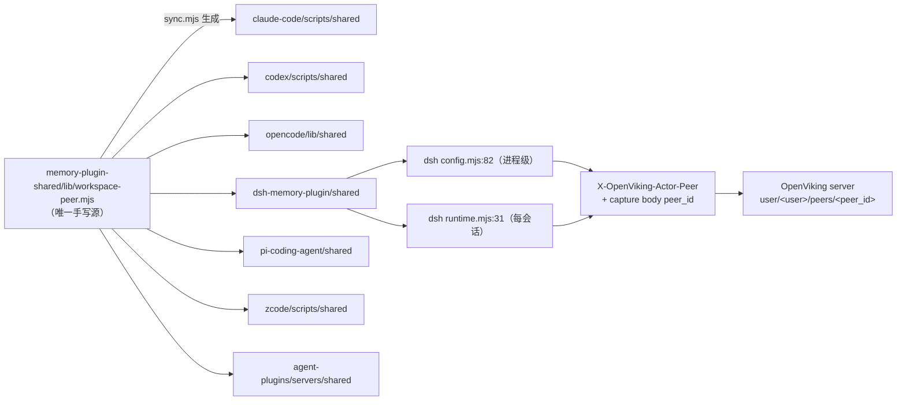
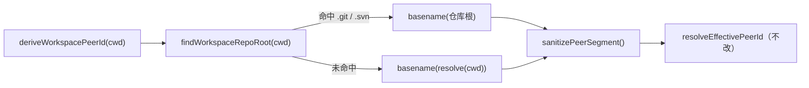

# 工作区 Peer 命名改造（仓库目录名）技术设计

## 文档信息

- **项目名称**: OpenViking 记忆插件工作区 peer 派生规则
- **创建日期**: 2026-09-02
- **版本**: v1.0
- **状态**: 已确认（用户口令 `确认设计`，2026-09-02）
- **相关需求**: requirements.md v1.0

## 系统架构

### 现有架构分析（唯一真相源 → 生成物 → 消费方）



**现状问题点唯一**：`deriveWorkspacePeerId()` 把整条绝对路径净化成一段字符串（`lib/workspace-peer.mjs:1-3`），使 peer 携带机器与用户差异。其余（优先级、开关、header 契约、服务端命名空间）均无需变更。

### 优化后的架构

架构拓扑**零变化**，仅 `deriveWorkspacePeerId` 的内部语义从「路径全量净化」变为「工作副本根的末层目录名净化」：



### 组件关系图

手写源只有 1 个文件；7 个副本与 10 处文档（8 个文件）均为派生物/说明物，不参与运行时决策。消费方（各 harness）通过 `resolveEffectivePeerId` 单一入口间接依赖，本次不改该入口签名与语义；cursor-memory-plugin 以直连相对路径 import 共享源的方式消费同一入口（v1.1 补正）。

### 技术栈

- **运行时**: Node.js `^22.19.0 || >=24`（`dsh-memory-plugin/package.json:67`），ESM（`.mjs`）
- **依赖**: 仅 `node:fs`、`node:path`、`node:os`（测试夹具）；零新增 npm 依赖
- **测试框架**: Node 内置 `node:test` + `node:assert/strict`
- **数据库 / 缓存 / 消息队列**: 不适用

## 核心组件设计

> 分类依据 02.prompt「代码片段边界规则」：**C1 为整文件重写（15 行小文件，展示完整新实现）**；C2/C3 仅说明变更；未变更代码不复制。

### 组件 C1: `examples/memory-plugin-shared/lib/workspace-peer.mjs`（唯一手写改动）

**职责**：把"工作目录"解析成"团队稳定的 peer 段"。

**接口定义（内部契约，签名保持不变）**：

```javascript
export function findWorkspaceRepoRoot(cwd: string): string;   // 新增导出，供独立单测
export function deriveWorkspacePeerId(cwd: unknown): string;  // 签名不变，语义变更
export function resolveEffectivePeerId({ cfg, cwd }): { peerId: string, source: "explicit"|"workspace"|"none" };  // 零改动
```

**完整新实现（替换现有 15 行文件正文，banner 由 sync 追加）**：

```javascript
import { existsSync } from "node:fs";
import { basename, dirname, join, parse, resolve } from "node:path";

/** Working-copy markers; both may appear as a directory or (git worktree/submodule) as a file. */
const GIT_MARKER = ".git";
const SVN_MARKER = ".svn";

/**
 * Walk upward from `cwd` to the directory that owns the version-controlled checkout.
 * Nearest `.git` wins, so a nested checkout belongs to its own project.
 * SVN 1.6 keeps a `.svn` in every directory while 1.7+ keeps one at the working-copy
 * root, so the outermost `.svn` is the one that names the checkout.
 * Returns "" for an empty argument or when no marker exists anywhere above.
 */
export function findWorkspaceRepoRoot(cwd) {
  const start = String(cwd || "").trim();
  if (!start) return "";
  let dir = resolve(start);
  const filesystemRoot = parse(dir).root;
  let outermostSvn = "";
  for (;;) {
    if (existsSync(join(dir, GIT_MARKER))) return dir;
    if (existsSync(join(dir, SVN_MARKER))) outermostSvn = dir;
    if (dir === filesystemRoot) break;
    dir = dirname(dir);
  }
  return outermostSvn;
}

/**
 * Peer segments travel in a header and a URI path, so anything the server would
 * reject as a path or a hidden file has to collapse to a hyphen first.
 */
function sanitizePeerSegment(value) {
  return String(value || "").replace(/[^A-Za-z0-9]/g, "-");
}

export function deriveWorkspacePeerId(cwd) {
  const start = String(cwd || "").trim();
  if (!start) return "";
  return sanitizePeerSegment(basename(findWorkspaceRepoRoot(start) || resolve(start)));
}

export function resolveEffectivePeerId({ cfg = {}, cwd = "" } = {}) {
  const explicit = String(cfg.peerId || "").trim();
  if (explicit) return { peerId: explicit, source: "explicit" };

  if (cfg.workspacePeer !== false) {
    const peerId = deriveWorkspacePeerId(cwd);
    if (peerId) return { peerId, source: "workspace" };
  }

  return { peerId: "", source: "none" };
}
```

**设计不变量**：

| 不变量 | 保证方式 | 对应需求 |
|---|---|---|
| 输出永不含 `/` `\` | 输入是 basename，再经白名单净化 | FR-002 / NFR-003 |
| 输出字符集 ⊆ 服务端 `^[a-zA-Z0-9_.@-]+$` 且永不为 `.`/`..` | `[^A-Za-z0-9]` 会把 `.` 一并替换，故净化结果不可能是 `.`/`..` | FR-004 |
| 同仓库跨机器同值 | 只用 basename，丢弃前缀路径 | FR-002 |
| 派生不抛异常 | `existsSync` 对 ENOENT/EACCES/EINVAL 一律返回 false（Node 文档语义，不抛）；`resolve`/`basename` 对已 `String()` 化的入参不抛 | FR-007 |
| 无子进程、无新依赖 | 仅 `node:fs` + `node:path` | NFR-001 / NFR-002 |
| `resolveEffectivePeerId` 行为零变化 | 该函数体逐字保留 | FR-005 / FR-006 |

**不做的设计（明确排除，避免过度实现）**：
- 不做 memoization：调用频次为「进程启动 1 次 + 每会话首次 1 次」（`runtime.mjs:28` states Map 已缓存），典型路径深度 ≤ 8 次 stat，无热点。
- 不加 `repo|path` 模式开关（用户裁决：全局统一仓库名）。
- 不解析 `GIT_DIR` / `.git` 文件内的 `gitdir:` 指向（bare repo 场景超出范围）。
- 不改 `pi-coding-agent-extension/shared/workspace-peer.d.mts`：`sync.mjs:74` 只同步 `.mjs`，且既有两个导出函数签名未变，新增导出无 TS 消费方。

### 组件 C2: 7 个生成副本（不手写）

| 目标文件 | 变更内容 |
|---|---|
| `examples/claude-code-memory-plugin/scripts/shared/workspace-peer.mjs` | 由 `node examples/memory-plugin-shared/sync.mjs` 重新生成（首行 banner + C1 正文） |
| `examples/codex-memory-plugin/scripts/shared/workspace-peer.mjs` | 同上 |
| `examples/opencode-plugin/lib/shared/workspace-peer.mjs` | 同上 |
| `examples/dsh-memory-plugin/shared/workspace-peer.mjs` | 同上（**用户诉求的直接生效点**） |
| `examples/pi-coding-agent-extension/shared/workspace-peer.mjs` | 同上 |
| `examples/zcode-memory-plugin/scripts/shared/workspace-peer.mjs` | 同上 |
| `agent-plugins/servers/shared/workspace-peer.mjs` | 同上 |

> 注意：`sync.mjs` 会同时重写 skills 与其他 shared 文件。执行后必须用 `git status` 核对**只允许** `workspace-peer.mjs` 系列发生变化；若出现其他 diff，说明副本本就漂移，需停下上报而不是提交。

### 组件 C3: 文档口径（10 处 / 8 文件，改描述与示例，不复制代码）

| 文件:行 | 现口径（需替换） | 新口径 |
|---|---|---|
| `docs/zh/agent-integrations/16-capability-reference.md:208` | 把路径中所有非字母数字字符替换成 `-`（`/Users/x/Dev/OpenViking` → `-Users-x-Dev-OpenViking`） | 向上定位 git/svn 工作副本根，取其末层目录名并净化（`/home/bob/Dev/OpenViking` → `OpenViking`）；无仓库时退回工作目录末层目录名；仍保留"含 `/`、`\` 服务端返回 400"的说明 |
| `docs/en/agent-integrations/16-capability-reference.md:206` | 同上英文 | 同上英文 |
| `examples/memory-plugin-shared/README.md:22-25` | 工作区派生段描述 | 补"仓库根末层目录名"定义 + SVN1.6 最外层 + 嵌套取内层三条语义 |
| `examples/claude-code-memory-plugin/README.md:143` | "Claude's project-directory naming rule" | 改为仓库目录名规则，并保留 header/body 落点说明 |
| `examples/codex-memory-plugin/README.md`（同段） | 同上 | 同上 |
| `examples/opencode-plugin/README.md:154` | workspace-derived peer | 同上 |
| `examples/pi-coding-agent-extension/README.md:91,119` | 同上两处 | 同上（表格行 `workspacePeer` 描述同步） |
| `examples/dsh-memory-plugin/README.md:124` + `claude-code-memory-plugin/skills/ov-memory-doctor/reference.md:34` | env 表 / doctor 表中的示例 `/Users/x/proj` → `-Users-x-proj` | 示例改为 `<repo-root>/…` → `<repo 目录名>` |

## API 设计

无新增/变更 HTTP 端点（NFR-003）。对外契约保持：

```
X-OpenViking-Actor-Peer: <sanitize(仓库根末层目录名)>
capture body: { peer_id: <同上> }
```

变更前后同位置取值示例（团队共享效果验证基准）：

| 机器 | 会话 cwd | 旧 peer | 新 peer |
|---|---|---|---|
| A | `/Users/alice/Documents/work/aigc/example-repo` | `-Users-alice-Documents-work-aigc-example-repo` | `example-repo` |
| B | `/home/bob/work/example-repo` | `-home-bob-work-example-repo` | `example-repo` ← 与 A 相同，达成共享 |
| 任意 | 无仓库的 `/tmp/scratch` | `-tmp-scratch` | `scratch` |

## 数据库设计

**不适用**：本改造为 Node 侧纯函数逻辑，无表、无 SQL、无 XML（requirements 证据核对第 4、5 项）。

## XML设计

**不适用**：同上。

## 序列图

### 主要业务流程（DSH 会话首次触达记忆）

```
DSH 会话启动 → runtime.stateFor(session)
   ├─ session.header.cwd || process.cwd()        [runtime.mjs:30]
   ├─ resolveEffectivePeerId({cfg, cwd})          [runtime.mjs:31]
   │     ├─ cfg.peerId 非空 → 直接返回 explicit   ← 本次不改
   │     └─ workspacePeer!==false → deriveWorkspacePeerId(cwd)
   │            ├─ findWorkspaceRepoRoot: 逐级 existsSync(.git/.svn)  ← 新增
   │            ├─ basename(仓库根) 或 basename(cwd)                  ← 变更
   │            └─ 净化 → peer
   ├─ state.config.peerId = peer
   └─ ensureSession/POST → X-OpenViking-Actor-Peer: peer + body peer_id: peer
                                        → server: user/<user>/peers/<peer>/…
```

### 优化前流程差异

仅 `deriveWorkspacePeerId` 一步：整条 `cwd` 净化 → peer 含用户名/家目录 → 同仓库跨机器不同值（导致无法共享）。

## 技术决策

### 决策1：仓库根的 git/svn 取法（git 最近、SVN 最外层、同级 git 优先）

**理由**：嵌套 checkout 应归属内层项目（在 `example-repo/dsh/OpenViking` 里工作，记忆属于 OpenViking）；SVN 1.6 每层都有 `.svn`，只有最外层才是工作副本根。
**风险**：与"外层 monorepo 统一共享"诉求相反（R-5）。
**备选方案**：① 一律取最外层 → 嵌套仓库场景下子项目记忆全部混入父仓；② 取 `git rev-parse --show-toplevel` → 违反 NFR-001（子进程）。

### 决策2：纯 fs 探测，不起子进程

**理由**：NFR-001 硬约束；`spawnSync` 在每次派生上加 5–30ms 与 PATH 依赖，且受限环境（无 git 可执行文件）会静默退化。
**风险**：无法处理 bare repo / `GIT_DIR` 间接指向（已明确排除）。
**备选方案**：`spawnSync("git",["rev-parse","--show-toplevel"])` + `svn info --show-item wc-root`（用户在 Phase 1 明确否决）。

### 决策3：保留净化规则不变

**理由**：跨机器一致（同名目录净化成同一串），且净化后字符集是服务端白名单子集；`.` 被替换掉，天然规避 `.`/`..` 非法值。
**风险**：中文目录名全净化成 `-`，可读性差（如 4 字中文目录名 → 4 个连字符，仍合法且同团队一致）。
**备选方案**：保留 `_`/`.`（服务端允许）→ 中文目录名仍无法保留，收益低且引入跨字符集差异，不做。

### 决策4：作用域为全局 shared 源（用户裁决）

**理由**：副本是生成物（`DO NOT EDIT`），无法只在 dsh 生效；且 peer 语义应跨 harness 一致。
**风险**：波及 6 个其他插件（R-2）；已取证唯一直接断言旧规则的测试只有 `memory-plugin-shared/workspace-peer.test.mjs`，且 CI 覆盖它。
**备选方案**：在 dsh 副本手工改 → 下次 sync 覆盖，产生静默漂移，不可接受。

## 性能考虑

### 响应时间目标

- 单次派生：向上 `existsSync` 次数 = 路径深度（典型 4–8），每步 1–2 次 stat，量级 < 1ms；远低于一次 HTTP 往返（`requestTimeoutMs` 默认 10000ms）。

### 内存占用

- 新增常量与栈变量，无缓存结构，增量可忽略。

### 并发处理

- 派生为纯同步 CPU/IO 短路径，无共享状态、无锁；每会话结果仍由 `runtime.mjs:28` 的 `states` Map 缓存。

### 可扩展性

- 后续若需要 org/repo 复合 peer 或 monorepo 包级 peer，可在 `findWorkspaceRepoRoot` 之后插入策略函数，消费方零改动。

### 性能优化策略

- 本次不做优化（无热点）；TC-08/TC-09 仅做"无回归"验证。

## 安全设计

### 认证授权

不涉及；仍复用既有 `Authorization: Bearer` 与 `X-OpenViking-Account/User` 头。

### 数据保护

- **个人路径不再外泄**：旧 peer 把用户名与家目录结构发到服务端与日志；新 peer 只发项目目录名，属隐私改善。
- **注入面**：peer 仅出现在 header 与 URI 段；净化白名单剔除 `/` `\` 换行 空格等，杜绝 header/路径注入（服务端 `identifiers.py:8` 为第二道闸）。

### 数据隔离

- 隔离键仍是 `peer_id`，粒度从"个人级"变为"项目级"（需求目标）。
- 需要人际隔离时使用 `OPENVIKING_PEER_ID` 显式指定，或 `OPENVIKING_WORKSPACE_PEER=0` 关闭派生。

### 访问控制

- 无新增权限面；服务端 peer 命名空间校验与 400 行为不变。

### 异常处理

- 派生路径任何文件系统异常均表现为 `existsSync → false`，最坏退化为 `basename(cwd)`，不向会话启动链路抛错（FR-007，TC 单测 `neverThrowsOnUnreachablePath` 固化）。

## 集成点

| 集成对象 | 契约 | 本次动作 |
|---|---|---|
| OpenViking server `peer_id` 校验 | `^[a-zA-Z0-9_.@-]+$`、非 `.`/`..`、`@`≤1 | 不改服务端；净化结果天然满足（单测固化不变量） |
| 各 harness CLI（claude/codex/opencode/dsh/pi/zcode/agent-plugins） | 经 `resolveEffectivePeerId` 复用 | 零代码改动，行为随 C1 变化 |
| claude-code 会话缓存层 `scripts/lib/workspace-peer.mjs` | 把 workspace peer 写入 `ws-peer-<sid>.json` | 不改动；老会话存活期内仍用旧缓存值（R-3），新会话即新值 |
| doctor 诊断 | `ov-memory-doctor.mjs:370/324` 复用同一函数 | 仅回归验证（FR-012） |
| CI | `pr.yml` 已含 `workspace-peer.test.mjs`、`sync.test.mjs`、`dsh-memory-plugin/*.test.mjs` | 无需改 workflow |

## 部署架构

### 环境要求

- **本地开发/验证**: 直接对 checkout 跑 `node --test`（Node 绑定 `NODE_PATH=/Users/alice/.nvm/versions/node/v23.11.0/bin/node`）
- **真实会话生效**: 需以改造后的插件装载并重启 harness profile（本机安装态为 `@openviking/dsh-memory-plugin@0.2.1`，`~/.dsh/profiles/web/node_modules/…`）
- **发布**: 各插件包版本发布由用户执行（构建打包职责分工）

### 配置项

无新增。既有 `OPENVIKING_PEER_ID` / `OPENVIKING_WORKSPACE_PEER` / `OPENVIKING_RECALL_PEER_SCOPE` 语义不变。

### 监控方案

无新增指标；验证以「doctor 输出的 peer 值」与「服务端 `peers/<name>` 目录名」为准。

## 风险评估

### 技术风险

| 风险项 | 影响程度 | 发生概率 | 应对措施 |
|---|---|---|---|
| sync 顺带重写其他副本，产生无关 diff | 中 | 中 | sync 后 `git status` 逐文件核对，只保留 `workspace-peer.mjs`；发现其他漂移即停止上报 |
| 未预料的 harness 测试断言旧 peer | 中 | 低 | 已取证唯一直接断言点在共享测试；仍全量跑 CI 测试清单 |
| `existsSync` 在特殊文件系统（网络盘/大小写不敏感）行为差异 | 低 | 低 | 未命中即回退 basename，不抛错；单测含不可访问路径用例 |
| 非 ASCII 目录名净化成全连字符 | 低 | 中 | 文档标注建议用 ASCII 目录名或显式 `OPENVIKING_PEER_ID` |

### 业务风险

| 风险项 | 影响程度 | 发生概率 | 应对措施 |
|---|---|---|---|
| 历史记忆在新 peer 下"看不见"（R-1） | 高 | 高 | 发布说明中明示；需要时以 `OPENVIKING_RECALL_PEER_SCOPE=all` 同账号跨 peer 召回；不做自动迁移（范围外） |
| 同仓库被 clone 成不同目录名 → peer 分裂（R-7） | 中 | 中 | 文档写明团队约定 clone 目录名，或显式 `OPENVIKING_PEER_ID` |
| 不同仓库同名目录碰撞（R-4） | 中 | 低 | 明示风险；必要时显式 peer 区分 |
| 人际隔离能力下降 | 中 | 中 | 安全设计节已给出显式覆盖手段 |

## 回滚方案

1. `git revert`（或还原）`examples/memory-plugin-shared/lib/workspace-peer.mjs` + `workspace-peer.test.mjs` + 文档改动；
2. 重跑 `node examples/memory-plugin-shared/sync.mjs` 使 7 副本回到旧规则；
3. 跑 `node --test` 记忆插件测试清单确认全绿；
4. **临时止血（无需回滚代码）**：为受影响机器设置 `OPENVIKING_PEER_ID=<旧整条路径净化值>`，即可立刻恢复旧 peer 可见性（explicit 优先级高于派生，FR-005）。

- **回滚时间**: < 5分钟

## 测试策略

### 影响范围

| # | 受影响功能点 | 影响方式 | 必须纳入人工回归 |
|---|---|---|---|
| 1 | DSH 会话记忆上报（capture/commit 的 `peer_id`） | 值变更 | ✅ |
| 2 | DSH 自动召回（recall 按 peer 组装上下文） | 命中集合变更 | ✅ |
| 3 | DSH profile 注入（携 peer） | 同上 | ✅ |
| 4 | DSH OpenViking MCP 代理工具（`mcp-proxy.mjs:27` boot peer，README:88 已知为进程级） | 值变更 | ✅ |
| 5 | claude-code / codex / opencode / pi / zcode / agent-plugins 同类链路 | 值变更 | ✅（至少各跑 1 次会话） |
| 6 | 显式 peer 部署（`OPENVIKING_PEER_ID`） | 不应变化 | ✅ |
| 7 | 关闭派生（`OPENVIKING_WORKSPACE_PEER=0`） | 不应变化 | ✅ |
| 8 | doctor 诊断输出 peer | 值变更 | ✅ |
| 9 | 官方文档/README 描述（10 处 / 8 文件） | 文案 | ✅ |

### 测试用例

**测试数据生成设计**（全部为本地目录夹具，不涉及数据库；database-skill **不适用**并已在此声明，理由：无表/无 SQL）：

```bash
mkdir -p /tmp/ovpeer/{plain,repo-git/.git,repo-svn17/.svn,repo-svn16/{sub/.svn,.svn},nested/outer/.git,nested/outer/inner/.git}
mkdir -p "/tmp/ovpeer/sp ace/Product 4.0"     # 含空格与点
mkdir -p /tmp/ovpeer/cjk/某某信托          # 非 ASCII 目录名
```

| 用例编号 | 环节分类 | 场景 | 操作 | 预期结果 |
|---|---|---|---|---|
| TC-01 | 人工集成 | 在 git 仓根启动 DSH 会话 | `cd <example-repo 仓库根>` 起会话并发一句话触发 capture；查看 doctor 或服务端 `peers/` 目录 | peer = `example-repo`（不含任何个人路径） |
| TC-02 | 人工集成 | 团队共享验证（核心目标） | 两台机器（或本机复制仓库到 `/tmp/u2/example-repo`）各自起会话 | 两处 capture 落到**同一** `peers/example-repo` |
| TC-03 | 人工集成 | 嵌套仓库 | 在 `example-repo/dsh/OpenViking` 内起会话 | peer = `OpenViking`（内层胜出，R-5 预期） |
| TC-04 | 人工集成 | svn 工作副本 | 在真实/伪造 svn WC 内起会话 | peer = WC 根目录名 |
| TC-05 | 人工集成 | 显式 peer 优先 | `OPENVIKING_PEER_ID=myteam` 在 git 仓内起会话 | peer = `myteam`，派生不生效 |
| TC-06 | 人工集成 | 关闭派生 | `OPENVIKING_WORKSPACE_PEER=0` 在 git 仓内 | 无 peer，capture 不带 actor peer（与改造前一致） |
| TC-07 | 人工集成 | 非仓库目录 | `cd /tmp/ovpeer/plain/deep` 起会话 | peer = `deep` |
| TC-08 | 人工性能 | 派生开销 | 循环 1000 次调用 `deriveWorkspacePeerId(<8层路径>)` 计时 | 平均 < 1ms/次，无 fd 泄漏（`lsof -p` 数量不增长） |
| TC-09 | 人工性能 | 冷启动不阻塞 | 在深层目录（10+ 级）启动插件，观察首条 turn 完成时间 | 与改造前无可感知差异（<50ms 差） |
| TC-10 | 人工回归 | 历史数据可见性 | 切换后发起一次与旧会话相关的提问 | 旧 peer 数据不再自动命中；`OPENVIKING_RECALL_PEER_SCOPE=all` 时可跨 peer 召回 |
| TC-11 | 人工回归 | 6 个其他 harness 各起 1 次会话 | claude-code/codex/opencode/pi/zcode/agent-plugins | 各自 peer 均为仓库目录名，功能无报错 |
| TC-12 | 人工回归 | 无 git/svn 可执行文件的环境 | 在禁用外部命令的环境起会话 | 正常派生（本方案不依赖外部命令） |

### 单元测试

测试类（文件）: `examples/memory-plugin-shared/workspace-peer.test.mjs`（**重写**：删除对旧整条路径命名的断言，改为临时目录夹具；夹具基址 `mkdtempSync(join(tmpdir(), "ov-peer-"))`，`try/finally rmSync({recursive:true})` 清理；**若 fixture 基址自身向上命中 marker，则跳过"精确等值"断言、仅断言字符集不变量**，保证 macOS/Linux 与 CI 双向确定）

- testFindWorkspaceRepoRoot_gitDirectoryMarker: Given `<tmp>/repo-git/.git/` 存在，When 以 `<tmp>/repo-git` 调用，Then 返回 `<tmp>/repo-git`
  断言: `findWorkspaceRepoRoot(dir) === dir`
- testFindWorkspaceRepoRoot_gitFileMarkerForWorktree: Given `.git` 是**文件**（worktree/submodule 形态），When 以该目录调用，Then 仍命中该目录
  断言: `findWorkspaceRepoRoot(wtDir) === wtDir`
- testFindWorkspaceRepoRoot_nestedGitTakesNearest: Given `nested/outer/.git` 与 `nested/outer/inner/.git`，When 以 `inner` 调用，Then 返回 `inner`
  断言: `findWorkspaceRepoRoot(inner) === inner`
- testFindWorkspaceRepoRoot_svn17SingleMarker: Given `repo-svn17/.svn`，When 从其子目录调用，Then 返回 `repo-svn17`
  断言: `findWorkspaceRepoRoot(sub) === wcRoot`
- testFindWorkspaceRepoRoot_svn16TakesOutermost: Given WC 根与子目录都有 `.svn`，When 以子目录调用，Then 返回**最外层**
  断言: `findWorkspaceRepoRoot(sub) === outermost`
- testFindWorkspaceRepoRoot_gitPreferredOverSvn: Given 同级同时存在 `.git` 与 `.svn`，When 调用，Then 返回该目录（git 优先）
  断言: `findWorkspaceRepoRoot(dir) === dir`
- testFindWorkspaceRepoRoot_noMarkerReturnsEmpty: Given 无任何标记的临时目录 / `""` / `null`，When 调用，Then 返回 `""`
  断言: `findWorkspaceRepoRoot(plain) === ""`；`findWorkspaceRepoRoot("") === ""`；`findWorkspaceRepoRoot(null) === ""`
- testDeriveWorkspacePeerId_sameRepoNameAcrossPrefixes: Given 两个不同前缀下的同名 git 仓，When 分别派生，Then 两者相等
  断言: `deriveWorkspacePeerId(aDir) === deriveWorkspacePeerId(bDir)`（团队共享核心回归，对应 TC-02）
- testDeriveWorkspacePeerId_sanitizesNonAlnum: Given 目录名 `Product 4.0`，When 派生，Then 得 `Product-4-0`
  断言: `peer === "Product-4-0"`；`assert.doesNotMatch(peer, /[\\/]/)`
- testDeriveWorkspacePeerId_nonAsciiKeepsServerCharset: Given 非 ASCII 目录名，When 派生，Then 结果仍匹配 `^[A-Za-z0-9_.@-]+$`
  断言: `assert.match(peer, /^[A-Za-z0-9_.@-]+$/)`（FR-004 不变量，防 400）
- testDeriveWorkspacePeerId_fallsBackToCwdBasename: Given 无标记的 `<tmp>/plain/deep`，When 派生，Then `deep`（祖先无标记时才做等值断言）
  断言: `deriveWorkspacePeerId(deep) === "deep"`
- testDeriveWorkspacePeerId_rootAndBlankReturnEmpty: Given `/`（POSIX）与 `""`/`null`/`"   "`，When 派生，Then 返回 `""`
  断言: `deriveWorkspacePeerId("/") === ""`；`deriveWorkspacePeerId(null) === ""`
- testDeriveWorkspacePeerId_neverThrowsOnUnreachablePath: Given 不存在 / 含 NUL 字节的路径，When 派生，Then 不抛异常且返回字符串
  断言: `assert.doesNotThrow(() => deriveWorkspacePeerId("/no/such/\0x"))` + `typeof === "string"`（FR-007）
- testResolveEffectivePeerId_prefersExplicitInsideRepo: Given 位于 git 仓内且 `cfg.peerId=" configured "`，When 解析，Then `{peerId:"configured", source:"explicit"}`
  断言: `deepStrictEqual(result, { peerId: "configured", source: "explicit" })`（FR-005）
- testResolveEffectivePeerId_workspaceUsesRepoName: Given 无显式 peer、cwd 为 `<tmp>/proj-x/.git` 仓内，When 解析，Then `{peerId:"proj-x", source:"workspace"}`
  断言: `deepStrictEqual(result, { peerId: "proj-x", source: "workspace" })`（替换旧 `-tmp-project` 断言）
- testResolveEffectivePeerId_disabledReturnsNone: Given `{workspacePeer:false}` 且位于 git 仓内，When 解析，Then `{peerId:"", source:"none"}`
  断言: `deepStrictEqual(result, { peerId: "", source: "none" })`（FR-006）

**既有下游测试不改断言、仅确认通过**：`dsh-memory-plugin/*.test.mjs`、`memory-plugin-shared/sync.test.mjs`、`memory-plugin-shared/recall-core.test.mjs`、opencode / pi / agent-plugins 各自测试。

## 附录

### 关键常量定义

```javascript
const GIT_MARKER = ".git";   // 目录或文件（worktree/submodule）均视为标记
const SVN_MARKER = ".svn";   // 1.6 每层都有 → 取最外层；1.7+ 仅根
```

### 依赖组件

- Node 内置：`node:fs.existsSync`、`node:path.{basename,dirname,join,parse,resolve}`
- 测试：`node:test`、`node:assert/strict`、`node:os.tmpdir`、`node:fs.mkdtempSync/rmSync`
- 零新增 npm 依赖

### 参考文档

- `openviking/core/identifiers.py:8`（peer_id 字符集）、`openviking/core/namespace.py:126`（peers 命名空间）
- `docs/{zh,en}/agent-integrations/16-capability-reference.md:206/208`（旧口径与 header 400 说明）
- `.github/workflows/pr.yml:25-95`（CI 记忆插件测试清单，验证口径以此为准）
- 历史提交 `2a81edc7 "Add workspace peer mode for memory plugins (#3099)"`（原始改动面：源 + 7 副本 + 4 处 README + CI 清单）
- 命名规范参照 `aegis-skill/languages/web-hs/javascript.md`（驼峰、常量全大写、变量名描述性；浏览器相关条目对本 Node ESM 文件不适用）

## 变更记录

| 版本 | 日期 | 变更内容 | 变更人 |
| ---- | ---- | -------- | ------ |
| v1.0 | 2026-09-02 | 初始设计：C1 单文件重写 + sync 生成 + 8 处文档 + 测试夹具与 16 个单测场景；4 项技术决策含备选与回滚止血手段 | AI 助手 |
| v1.1 | 2026-09-02 | Phase 4 执行期补正：文档口径按实际计数为 10 处 / 8 文件；消费面补入 cursor（直连相对路径 import 共享源，无自有派生实现但测试断言属改动面）；补 4 处消费方层测试断言为合法改动面 | AI 助手 |
